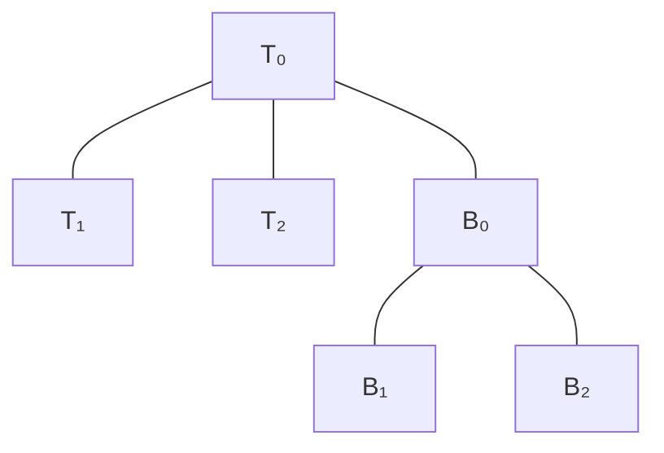

# The completed five-vertex theorem

[Bipyramid.lean](SixVertexUnfolding/Bipyramid.lean) proves that every convex
polyhedron with at most five genuine vertices has an original-edge unfolding.
It uses the unchanged public definitions. There are no admitted lemmas in its
dependency chain, and the project-wide axiom audit passes.

The quadrilateral-facet case is a pyramid, already handled by
[Pyramid.lean](SixVertexUnfolding/Pyramid.lean). Otherwise the original facets
are exactly those of a triangular bipyramid. Write `Tᵢ` and `Bᵢ` for the upper
and lower facets omitting equator vertex `i`, and choose equator vertex 0 as
source. The construction retains these five original hinges:

The diagram records face adjacencies, not planar coordinates. The retained
hinges form a tree; the four original source edges form the complementary
primal spanning tree. **All 15 distinct face pairs are proved nonoverlapping.**

## Proof map

1. [FiveVertexTriangularGraph](SixVertexUnfolding/Geometry/FiveVertexTriangularGraph.lean)
   identifies the poles as the unique nonadjacent pair. The facet and dual-graph
   modules identify all six original triangles and every original hinge.
2. [BipyramidDevelopment](SixVertexUnfolding/Geometry/BipyramidDevelopment.lean)
   develops each three-face cap and joins the central bases. This already
   separates six same-cap pairs and the central pair.
3. [BipyramidRadon](SixVertexUnfolding/Geometry/BipyramidRadon.lean) proves that
   the pole segment crosses the equator triangle strictly away from its edges.
   [BipyramidWeights](SixVertexUnfolding/Geometry/BipyramidWeights.lean) extracts
   positive coefficients for that affine dependence.
4. [RadonMetric](SixVertexUnfolding/Geometry/RadonMetric.lean) proves an exact
   weighted squared-distance identity. In a placed petal, seven distances stay
   fixed and two increase; the identity forces the remaining pole-to-source-copy
   distance to increase too. [BipyramidMetric](SixVertexUnfolding/Geometry/BipyramidMetric.lean)
   applies this to the actual original and placed vertices.
5. [BipyramidPetals](SixVertexUnfolding/Geometry/BipyramidPetals.lean) separates
   all four opposite-cap petal pairs by perpendicular bisectors between their
   source copies. The vertex inequalities extend to the whole convex faces.
6. [BoundaryBarrier](SixVertexUnfolding/Geometry/BoundaryBarrier.lean) proves
   that a convex face cannot enter another face whose boundary is covered by
   already-safe neighbors, provided it has a point outside that face.
   [BipyramidPlacedFaces](SixVertexUnfolding/Geometry/BipyramidPlacedFaces.lean)
   verifies the three-edge covers and the outside-pole conditions.
7. [BipyramidNonoverlap](SixVertexUnfolding/Geometry/BipyramidNonoverlap.lean)
   settles the last four base/petal pairs and assembles the public unfolding.
   [Bipyramid.lean](SixVertexUnfolding/Bipyramid.lean) combines this with the
   pyramid and tetrahedron cases to finish the theorem through five vertices.

This proof does not depend on a general shortest-path star-unfolding theorem or
on the unfinished equator-curvature positivity argument. The earlier curvature
results remain available for later work. The general dual-tree/abstract-disk
equivalence is still a separate unfinished bridge lemma; the public unfolding
predicate, including whole-face rigidity and whole-hinge agreement, is proved.

The remaining main-theorem case has exactly six vertices, with every original
facet triangular or quadrilateral. The separate research manuscripts have not
been modified.
