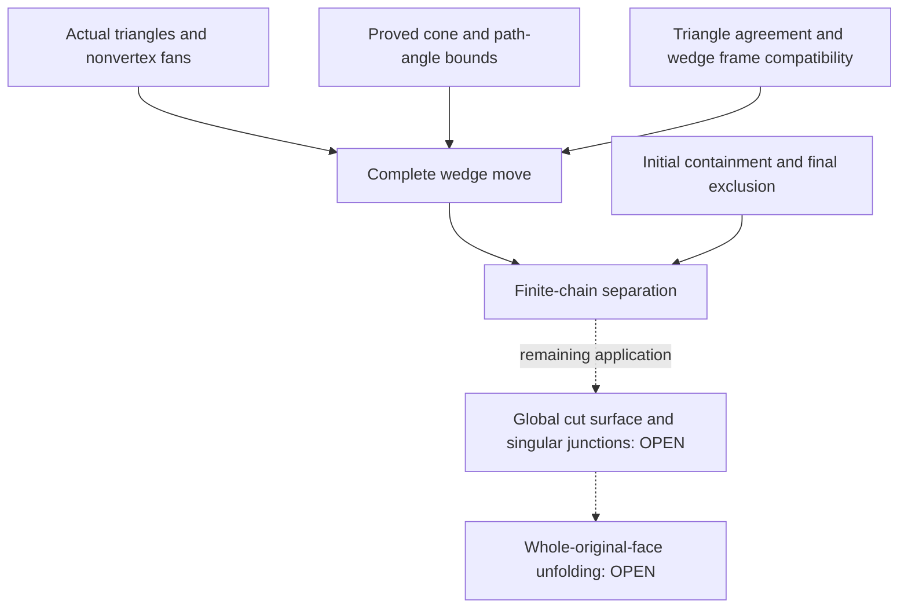

# Checked wedge-chain argument

The planar chain argument now has a checked beginning, step, coordinate
change, iteration, and ending. This is still not the complete star-unfolding
theorem: its application to the entire cut surface remains unfinished.

Solid arrows connect checked ingredients. Dashed arrows mark the unfinished
global application; the last two boxes are not established theorems.

## First kite

[InitialKiteWedge.lean](SixVertexUnfolding/Geometry/InitialKiteWedge.lean)
proves that an actual incident kite lies in its incoming wedge with outer
angle `π/2 + sourceAngle`. Its far endpoint may be an original vertex;
the proof uses the metric triangle, not a flat chart at that endpoint.

## One step and its change of coordinates

[JunctionDevelopedKites.lean](SixVertexUnfolding/Geometry/JunctionDevelopedKites.lean)
identifies the gap kite with the two complete developed surface triangles.
The actual route labels determine its two source copies.

[CutEdgeReversalAgreement.lean](SixVertexUnfolding/Geometry/CutEdgeReversalAgreement.lean)
aligns opposite orientations of an edge by one rigid motion and one
consistent source-label correspondence. Both complete triangle maps agree.
[JunctionEdgeTransitions.lean](SixVertexUnfolding/Geometry/JunctionEdgeTransitions.lean)
transfers that agreement to independently chosen junction charts.

A centered wedge depends on its radius and ordinary angle from its axis.
[CenteredWedgeFrames.lean](SixVertexUnfolding/Geometry/CenteredWedgeFrames.lean)
therefore handles reflected charts as well as rotated charts.
[NextWedgeParameters.lean](SixVertexUnfolding/Geometry/NextWedgeParameters.lean)
identifies the returned radius and half-gap with the actual next triangle.
[IncidentWedgeTransitions.lean](SixVertexUnfolding/Geometry/IncidentWedgeTransitions.lean)
then identifies the entire returned wedge with the next incoming wedge.

[CutTreeWedgeMoves.lean](SixVertexUnfolding/Geometry/CutTreeWedgeMoves.lean)
constructs one record containing the enlarged region, exclusion of the
actual kite interior, exact addition, and agreement of both triangle maps.
Its path constructor discharges the angle budget using the source cone.
[CutTreePathRegions.lean](SixVertexUnfolding/Geometry/CutTreePathRegions.lean)
identifies the new outer angle with the extended path's exact angle sum.
[PathJunctionSteps.lean](SixVertexUnfolding/Geometry/PathJunctionSteps.lean)
selects the needed angular indices from the actual tree edges, using the
chosen fans at two successive nonvertex junctions.

## Finite iteration and last kite

[ExpandingRegionChains.lean](SixVertexUnfolding/Geometry/ExpandingRegionChains.lean)
pulls every successive coordinate plane back to the first plane. The
carried regions grow; each new kite is enclosed and misses all earlier
kites in its interior. The endpoint theorem carries an initially enclosed
set through any finite number of these steps and separates it from a
final excluded kite. The coordinate identities also preserve agreement
of the actual triangle maps via `AgreesAfter.in_common_frame`.

[JunctionTerminalStep.lean](SixVertexUnfolding/Geometry/JunctionTerminalStep.lean)
excludes the last kite without requiring a chart at its far endpoint.
[JunctionKiteSeparation.lean](SixVertexUnfolding/Geometry/JunctionKiteSeparation.lean)
already applies the initial and terminal steps to any two whole kites at
one nonvertex junction. Their angle budget is proved from the actual source
cone; it is not a premise supplied by the caller.
[TwoJunctionSourceBudget.lean](SixVertexUnfolding/Geometry/TwoJunctionSourceBudget.lean)
proves separation across two different junctions as well. Its three-angle
budget is supplied by the actual source cone, and the returned move retains
the full middle-kite triangle agreement.

## Exact remaining boundary

The finite-chain theorem accepts a sequence of the stated region steps.
The actual nonvertex constructions supply each such step, but the full
star proof must still assemble them over its complete surface partition.
In particular, no global cut quotient has yet been constructed, and no
argument here handles passing through an original vertex as an internal
junction. Initial or final kites ending at a vertex are covered; internal
singular junctions are a different issue.

The source and star-cut rays must retain their distinct copies. A union
of the original surface strips would wrongly identify those copies.
After the global assembly, the proof still must transfer the construction
to rigid whole-original-face placements and an original hinge tree.
The separate universal-vertex five-ray avoidance and prism-diagonal
fallback/switch arguments also remain open. See [STAR_NEXT.md](STAR_NEXT.md).
