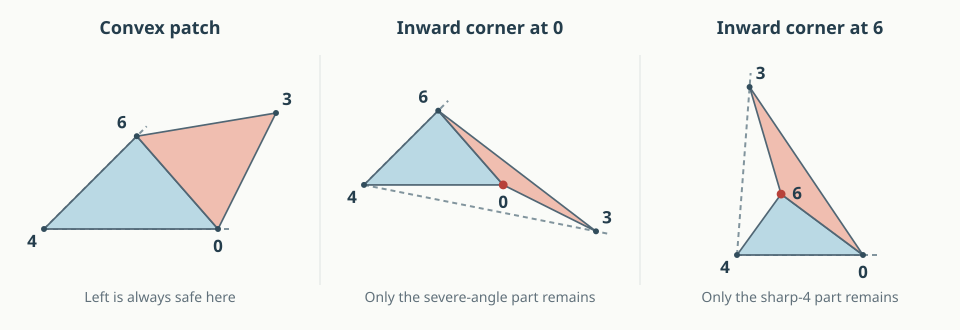
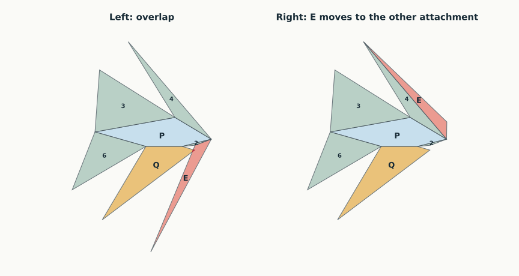
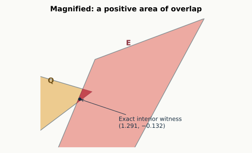

# N7-A992: one triangle needs the right attachment

12 September 2026. **The whole graph remains open.** The original one-pair
reduction is correct, but its proposed fixed cut tree really can overlap.
The results below replace that false candidate with a sharper question:
**can one of two attachments of triangle 036 always be made safe?**

**Latest progress:** E/235 now has a geometric proof in R0 when the two base
hinges converge or are parallel. Together with the E/135 proof, this leaves
**only E/Q in that family**. The divergent-hinge family still needs E/235.
[Read the new proof and see the three base-edge cases](A992_BASE_EDGES.html),
or [see the complete obligation table](#next-lemma).

[Back to the graph map](index.html#N7-A992) ·
[General pair lemmas](ARGUMENTS.html#cofacial-core) ·
[Exact certificates](results/a992-exact-counterexample.json)

## The shape and the proposed rule

Think of this polyhedron as a pentagonal base with a roof. Five roof faces
share an edge with the base. Only **one triangle, 036**, has no base edge.
Call it **E**. Call the quadrilateral 0324 **Q**, and the base 15246 **P**.

Unfold P and its five edge neighbors first. That six-face arrangement is
safe for every convex realization, by the established face-neighborhood
theorem. We then have to place E. It can stay attached along 06 to triangle
046, along 36 to triangle 136, or along 03 to Q.

The first two options are especially attractive: changing between them
moves **only E**. The rest of the page uses these names:

| Rule | Keep E attached along | Cut these six original edges | Pairs still needing a geometric argument |
| --- | --- | --- | --- |
| **Left** (original candidate) | 06, to triangle 046 | 03, 04, 13, 23, 35, 36 | E / Q |
| **Right** (new fallback) | 36, to triangle 136 | 03, 04, 06, 13, 23, 35 | E / Q; E / 135; E / 235 |

Both lists are spanning cut trees. **Left has 20/21 pairs settled; Right has
18/21.** These are universally justified pair counts for those particular
trees. They do not mean that the graph proof is 95% or 86% complete.

## New: the first failure has only two possible forms {#cone-progress}

Flatten triangle 046 together with E along their common edge 06. The pair
forms one patch. Its shape tells us where a proof is still needed:

<figure><figcaption>The sketches show the patch types. The exact conditions below settle all but two restricted regimes. They do not measure a fraction of shape space.</figcaption></figure>

| Patch type | Proved for every realization meeting the condition | Remaining regime |
| --- | --- | --- |
| Convex | **Left works** | None |
| Inward at 0 | **Left works** if $2\kappa_0+2q_0+\kappa_4\ge\pi$ | **R0:** a more severe inward angle, exceeding $270^\circ+\kappa_4/2$ |
| Inward at 6 | **Left works** if $\angle430\le90^\circ$ or $\angle246+\angle640\ge90^\circ$ | **R6:** both conditions fail, forcing curvature at 4 above $180^\circ$ |

Here $q_0$ is Q's face angle at 0, and $\kappa_x$ is the curvature at a
vertex: $360^\circ$ minus the sum of face angles there. Formulas use radians.
The R0 regime forces curvature at 4 **below** $180^\circ$; R6 forces it
**above**. **At exactly $180^\circ$, Left always works.**

The proof encloses each end piece in a cone at 4. For an inward corner at 6,
a triangle comparison bounds how far the patch can reach. For an inward
corner at 0, the cut edge 03 supplies a separating line. This extends a useful
idea from the six-vertex work, with the new inequalities proved separately.

[Read the complete cone proof, including equality cases](A992_CONES.html).
The second regime really occurs: a [new exact example](A992_CONES.html#r6-example)
has an inward corner at 6 and Left overlap; Right repairs that shape.

**The repair proof has now advanced:** [E/135 is proved safe throughout R0](A992_R0.html).
[E/235 is also proved for converging or parallel base hinges](A992_BASE_EDGES.html).
E/Q is still open throughout R0, and E/235 in the divergent-hinge part.
The three R6 obligations remain open. The page below keeps the earlier exact
failures and lists the [remaining implications](#next-lemma).

## A real failure, with a real repair {#counterexample}

<div class="a992-model" data-example="box"><svg viewBox="0 0 620 400" role="img" aria-label="Rotatable convex seven-vertex counterexample"></svg><div class="model-controls"><button type="button" data-action="left">Left cuts</button><button type="button" data-action="right">Right cuts</button><button type="button" data-action="rotate">Rotate</button><button type="button" data-action="reset">Reset view</button></div><p class="small">Drag to rotate the exact center shape. Red edges are cut. Amber: Q. Coral: E. Blue: pentagonal base P. Geometry is shown without stretching.</p></div>

<figure><figcaption>Left overlaps. Right unfolds the same polyhedron safely. The six-face arrangement around P is identical in both pictures.</figcaption></figure>

<figure><figcaption>The highlighted intersection contains the rational point (1.291, −0.132). This is positive interior overlap, not just two boundaries touching.</figcaption></figure>

Here are exact coordinates for the displayed solid. Terminating decimals
in this table denote rational numbers, not rounded measurements.

| Vertex | x | y | z |
| --- | ---: | ---: | ---: |
| 0 | 1.34 | 0.085 | 0.055 |
| 1 | 0.8 | 0.8 | 0 |
| 2 | 0 | 0 | 0 |
| 3 | −1.2 | 1.7 | 1.1 |
| 4 | 1 | 0 | 0 |
| 5 | −1.4 | 0.4 | 0 |
| 6 | 1.8 | 0.2 | 0 |

The check establishes the seven stated facets, their strict convexity, and
the two unfolded placements. It proves that the marked point lies strictly
inside **both** Q and E in Left. For Right, the three remaining pairs have
strict separating lines; the other 18 use the written general pair lemmas.

There is a stronger result than a single example: **all these conclusions
hold on an 11-parameter box of half-width 1/100000** around this shape, in
the coordinates described below. Thus Left fails and Right works throughout
a full-dimensional family of this graph. This box preserves the required
planarity identities. It is not a box of 21 independently perturbed vertex
coordinates, which would generally destroy the polygonal faces.

The arithmetic uses integer bounds rounded outward, including square roots.
Every one of the seven inequalities putting the witness inside Q and E has
lower bound greater than **0.0136** on this box. The three Right separators
have projection gaps greater than **0.1999**, **0.8246**, and **4.4338**.
The directions are not normalized, so these gaps are not Euclidean distances.
The complete rational bounds are in the [certificate](results/a992-exact-counterexample.json).
These are checked finite certificates with stated geometric-lemma dependencies;
they are not Lean formalizations or universal graph proofs.

## What has actually been ruled out {#failed-rules}

| Proposed rule | Result | Evidence |
| --- | --- | --- |
| Always use Left | **False** | Exact counterexample, and an 11-parameter failure box |
| Keep source 3 and merely switch Q between its two possible hinges | **Insufficient** | Both source-3 trees overlap on the same exact shape |
| Attach E along the longer of 06 and 36 | **False** | Exact rational shape with 36 strictly longer, but Right overlaps; Left works there |
| Try Left; if it overlaps, use Right | **Open** | No joint failure found in the recorded searches; the three implications below still need proof |

The [two-source-3 certificate](results/a992-two-source3-counterexample.json)
checks overlap in each tree and a successful tree from source 4 on that
same shape. The [longer-edge certificate](results/a992-length-rule-counterexample.json)
checks the strict length ordering, the overlap, and the successful Left net.
These failures disprove proposed **rules**, not edge unfoldability of the graph.

```{=html}
<details><summary>Keep the experimental history: why the first sample was misleading</summary>
```

An initial survey tested 15 distinct cofacial cut trees on 1,200 valid
samples, including five previously discovered Left failures. A source-4
candidate had no observed failures. Targeted optimization then found apparent
failures for each of its four unresolved pairs. We therefore did not promote
that candidate to a theorem.

A later sample of 1,800 valid shapes found no failure of the longer-edge
choice. Targeted optimization found one; it was then converted to the exact
certificate linked above. The two-attachment and three-attachment searches
also approached nearly flat shapes where floating signs became tiny. These
are inconclusive boundary cases, not certified failures or successes.

A new search deliberately sampled the sharp-4 regime missed by the first
sampler. It extended 154 apparent Left failures to the full seven-vertex graph.
One became the exact R6 certificate linked above. A second search froze each
of 159 local obstructions and varied only vertices 1 and 5, as permitted by
the localization lemma. It found no robust joint failure in 2,086 valid
extensions. This strengthens the search strategy, not the universal claim;
near-zero floating scores remain inconclusive.

All discovery logs and their scripts are retained separately. None is used
as a premise of a positive proof.

```{=html}
</details>
```

## A useful proved reduction: only five vertices cause the first obstruction {#localization}

**Localization lemma.** Whether Q overlaps E in Left depends only on vertices
0, 2, 3, 4, and 6. It is independent of where vertices 1 and 5 are placed,
provided the full convex polyhedron still has the stated graph.

**Proof.** The unique hinge path from Q to E is

**Q → P → triangle 046 → E**, across hinges **24, 46, and 06**.

Inside P retain just the triangle 246. It lies in P and keeps the two hinges
24 and 46 in exactly the same relative position. Replacing P by this triangle
therefore leaves the relative placements of Q and E unchanged.

The convex hull of 0, 2, 3, 4, and 6 is a quadrilateral pyramid: its base is Q
and its apex is 6. Its other faces are 036, 046, 246, and 236. Its cut tree
03, 04, 23, 36 develops the displayed Q–246–046–E path exactly as Left does.
Thus the unresolved pair is already a particular unfolding obstruction in
that five-vertex pyramid. Vertices 1 and 5 never enter the calculation. □

This reduces the first obstruction from **11 metric parameters to seven**.
It also explains why knowing that every quadrilateral pyramid unfolds does
not finish our problem: the easy pyramid star at 6 cuts the auxiliary segment
26. Segment 26 is a diagonal inside the original pentagonal face, not an
allowed edge cut of N7-A992.

## The precise next lemma {#next-lemma}

The next target is a conditional repair statement, rather than another fixed
tree or an unproved length heuristic:

> **Two-attachment conjecture.** For every convex realization of N7-A992,
> if Left has interior overlap, then Right has no interior overlap.

By the universal pair reductions, its entire missing content is the following
three implications. Here “Left fails” means its Q and E have intersecting
interiors.

The cone theorem splits each implication into R0 and R6. Of these six
conditional statements, **one is completely proved and a second has a proved
subcase**; five are still not fully closed. Every proved entry below has a
geometric argument. Numerical searches do not supply the proofs.

| Under actual Left overlap | R0: severe inward corner at 0 | R6: inward at 6, sharp vertex 4 |
| --- | --- | --- |
| Right keeps E disjoint from Q | Open | Open |
| Right keeps E disjoint from triangle 135 | **[Proved](A992_R0.html)** | Open |
| Right keeps E disjoint from triangle 235 | **[Proved for converging or parallel hinges](A992_BASE_EDGES.html)**; divergent case open | Open |

**Why the green entry holds.** R0 makes E's angle at 0 obtuse. Localize the
E/135 pair to the convex hull of vertices 0, 1, 3, 5, and 6. Adding its auxiliary
triangle 056 gives a second copy of vertex 0, joined to 6 by an edge of exactly
the same length as E's copy. A hypothetical overlap would trap that auxiliary
triangle. The equal lengths force an angle inequality that contradicts the
obtuse angle at 0. The [full proof](A992_R0.html) includes the easier cone cases,
the containment argument, and the exact positive identity.

**The second proved family.** Put $\alpha=\angle162$ and $\beta=\angle625$,
the two angles next to diagonal 26 in the reduced base quadrilateral 6152.
If $\alpha+\beta<\pi$, the extended hinges 61 and 25 meet at a new point x.
They bound a larger triangle that brings E/235 within the old obtuse-petal
lemma. Parallel hinges, $\alpha+\beta=\pi$, follow by continuity. Thus
Right has **20/21 pairs settled in this R0 family**, with only E/Q left.
The [new illustrated proof](A992_BASE_EDGES.html) checks the auxiliary solid
and explains why the divergent case cannot use the same construction.

**Why these three would suffice.** All six faces other than E are edge
neighbors of P, so their 15 pairs are safe. In Right, E, 136, P, and 046 form
consecutive pieces around vertex 6 along their uncut paths, settling E against
136, P, and 046. Only the three pairs in the table remain. In Left, the
cofacial-core theorem at source 3 additionally settles E against 135 and 235;
only E/Q remains. Therefore the three conditional implications would prove
an original-edge unfolding for every realization of this graph. □

For a specified shape, an exact separating-axis test decides the initial
pair: Q and E are convex polygons, so it suffices to examine the normals to
their seven edges, in either orientation. Boundary contact is allowed; positive
interior intersection is failure. The interval checker conservatively returns
“not certified” if bounds straddle zero, rather than deciding a near-zero
case from floating arithmetic.

The recorded searches support investigating this conjecture but do not prove
it. The fallback has a different purpose from switching Q's hinge: it leaves
Q in place and moves E. The exact failure of both source-3 trees therefore
does not refute this conjecture.

## Coordinates, certificates, and reproducibility {#verification}

After a rigid motion and uniform scaling, use

$$p_2=(0,0,0),\quad p_4=(1,0,0),\quad
p_6=(x_6,y_6,0),\quad p_1=(x_1,y_1,0),\quad p_5=(x_5,y_5,0),$$
$$p_3=(X,Y,Z),\qquad p_0=a p_3+b p_4.$$

There are eleven parameters. The quadrilateral requires $a>0$, $b>0$,
$a+b>1$; the base is strictly convex, $Z>0$, and all seven facets must support
the other vertices strictly. These are tested directly, not assumed from
approximate graph recognition. The displayed center parameters are

$$(x_6,y_6,x_1,y_1,x_5,y_5,X,Y,Z,a,b)
=(1.8,.2,.8,.8,-1.4,.4,-1.2,1.7,1.1,.05,1.4).$$

The first obstruction omits $x_1,y_1,x_5,y_5$, leaving seven parameters.

For completeness, the checker develops each child face without trigonometry.
Let a hinge have planar endpoints $A,B$, vector $d=B-A$, and squared length
$L^2$. For a new corner with squared spatial distances $r^2,s^2$ from the
hinge endpoints, put $D=r^2-s^2+L^2$. Its developed position is

$$A+\frac{D}{2L^2}d
\ \pm\ \frac{\sqrt{4L^2r^2-D^2}}{2L^2}R_{90}(d).$$

Choose the sign opposite the parent face across the hinge. Strict convexity
puts every nonhinge corner on that side. The formula is just the two
squared-distance equations solved along and perpendicular to the hinge.
Outward rational interval operations enclose the exact position. Supporting
facet determinants, polygon corners, strict witness-point inequalities, and
residual separating axes are then replayed from the input parameters.

Run `python3 -B -m n7.a992_exact` from the n7 worktree to replay the saved
certificates. [The checker](a992_exact.py) uses rational integer arithmetic
for geometric signs; the separate [discovery code](a992.py) uses floating
arithmetic to find examples and draw figures. The
[experiment recipes](experiments/a992/README.md) preserve the finite searches.

All edits and results are confined to `n7/` in the separate worktree. The
six-vertex proofs and their Lean formalization are unchanged by this work.

<script src="a992-model.js"></script>
