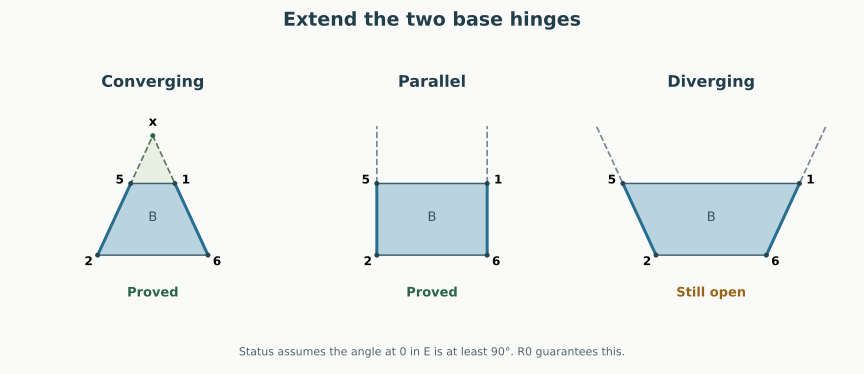

# N7-A992: a second R0 obligation now has a proved subcase

**Written geometric proof, 12 September 2026.** Right keeps E = 036
away from triangle 235 whenever E's angle at 0 is at least 90° and the
two relevant base edges converge, or are parallel, when extended.
This settles a whole additional geometric family inside R0.
The divergent-edge family and the complete graph remain open.

[Back to the case table](A992.html#next-lemma) ·
[The obtuse-petal proof used here](A992_R0.html) ·
[Seven-vertex overview](index.html#N7-A992)

## The geometric idea {#idea}

The previous E/135 proof worked inside a triangular bipyramid on five
vertices. E/235 initially seems harder: its path crosses a quadrilateral
inside the pentagonal base, so the relevant hinges no longer meet.

But sometimes their **extensions** meet. Extend edge 61 beyond 1 and edge
25 beyond 5. If they meet at a point x, the relevant base quadrilateral
fits inside triangle **x62**. The roof triangles 136 and 235 fit inside the
larger triangles **x36** and **x23**. The old five-vertex lemma can then be
applied to these larger triangles. Disjoint larger pieces imply disjoint
original pieces.

This is a comparison construction. Vertex x and all added segments belong
only to the proof. The final unfolding still uses the six original Right
cuts **03, 04, 06, 13, 23, 35**.

<figure><figcaption>Schematic base quadrilaterals, viewed from above. Dashed lines extend the hinges. In the converging case, the larger triangle is a comparison surface; the original pentagon's vertex 4 is outside this reduced picture.</figcaption></figure>

## Exactly which cases this settles {#cases}

Set

$$\alpha=\angle162,\qquad \beta=\angle625,$$

both measured in the base plane. These are the two angles next to diagonal
26 in the strictly convex quadrilateral **6152**. Each lies in $(0,\pi)$.

> **Base-edge extension theorem.** For every convex realization of N7-A992,
> if $\angle603\ge\pi/2$ and $\alpha+\beta\le\pi$, then E and triangle
> 235 have disjoint interiors in Right.

| Base-edge geometry | Angle test | E/235, when $\angle603\ge90^\circ$ |
| --- | --- | --- |
| Extensions meet beyond 1 and 5 | $\alpha+\beta<\pi$ | **Proved by the larger bipyramid** |
| Extensions are parallel | $\alpha+\beta=\pi$ | **Proved by continuity** |
| Extensions diverge | $\alpha+\beta>\pi$ | **Open** |

The test can also be made without evaluating angles. Orient the base plane
so that 6, 1, 5, 2 occur counterclockwise, and put

$$\Delta=\det(p_1-p_6,\ p_5-p_2).$$

Then $\Delta<0$ means converging, $\Delta=0$ means parallel, and
$\Delta>0$ means diverging. Indeed the directed angle between the two
ray directions is $\alpha+\beta-\pi\in(-\pi,\pi)$, so its sine has
the sign of $\alpha+\beta-\pi$.

R0 already forces $\angle603>\pi/2$, so the extra test there is simply
$\alpha+\beta\le\pi$. This is a **partial closure of the E/235 obligation**,
not a second completely closed cell in the original six-cell table.

The original six-cell count is still **one completely proved obligation
and five not yet completely proved**. One of those five now has the explicit
proved subcase above. In this R0 subcase, Right has **20 of 21 pairs settled**;
only E/Q remains. More explicitly:

| Obligation | R0 | R6 |
| --- | --- | --- |
| E avoids Q | Open | Open |
| E avoids 135 | **Proved throughout R0** | Open |
| E avoids 235 | **Proved for $\alpha+\beta\le\pi$**; divergent case open | Open |

No fraction of shape space or proof effort is being inferred from this table.

## 1. Localize the pair without changing its placement {#localization}

The hinge path in Right is

**036 → 136 → P → 235**, across **36, 16, and 25**.

Replace P by its internal quadrilateral $B=\operatorname{conv}\{6,1,5,2\}$.
The hinges 16 and 25 remain in the same relative position. The pair's
placement is unchanged. The discarded base triangle 246 and vertex 4
are not used in this placement argument.

In the following proof x is a new point in the base plane. It is not one
of the seven original vertices.

## 2. The converging case gives a genuine convex bipyramid {#bipyramid}

Suppose $\alpha+\beta<\pi$. Elementary planar geometry of the convex
quadrilateral gives an intersection

$$x=p_6+t(p_1-p_6)=p_2+s(p_5-p_2),\qquad t>1,\quad s>1.$$

Thus 1 is strictly between 6 and x, and 5 strictly between 2 and x.
In particular $B\subset\triangle x62$.

The convex hull of **0, 3, 6, 2, x** is a triangular bipyramid with poles
0 and x and equator 362. Its six facets are

$$036,\quad 062,\quad 023,\qquad x36,\quad x62,\quad x23.$$

Here is the supporting-plane check; convexity of this auxiliary solid is
part of the proof, not an assumption.

- Plane x36 is the original plane 136. It supports 0 and 2 strictly.
  Plane x23 is the original plane 235 and supports 0 and 6 strictly.
- Plane x62 is the base plane and supports 0 and 3 strictly.
- Plane 036 supports 2 strictly. Since $x-6=t(1-6)$ with $t>0$, it
  supports x on the same strict side as original vertex 1.
- Plane 023 is the original plane of Q. It supports 6 strictly. Since
  $x-2=s(5-2)$ with $s>0$, it supports x on the same strict side as 5.
- For plane 026, the intersection with the base plane is line 26.
  Vertices 1 and 5, and hence x, lie on the same side of that line;
  vertex 4 lies on the opposite side, by strict convexity of the original
  pentagon. Diagonal 02 of Q puts 3 and 4 on opposite sides of plane 026.
  Therefore 3 and x lie on the same strict side of plane 026.

All six listed triangles are nondegenerate and strictly supporting. They
close into the stated triangular bipyramid. Equivalently, each listed
triangle is a facet of the hull, and a five-vertex convex three-polytope
has at most six facets, so no additional facet is missing.

## 3. Apply the proved obtuse-petal theorem {#application}

Unfold the three faces $x36,x62,x23$ into a fan at x, with slit x3.
Attach 036 along 36. This is precisely the placement in the
[obtuse-petal theorem](A992_R0.html#setup), with labels

$$v=0,\quad w=x,\quad a=3,\quad c=6,\quad d=2.$$

The hypothesis on the petal is unchanged: $\angle603\ge\pi/2$.
The theorem makes **036 disjoint from the whole triangle x23**.

To identify the original placement, first align the large base triangle
x62 with B in the original base plane. Triangle 136 is a subtriangle of
x36, with its hinge 16 on the same line as x6. Both are developed outward
from the same base half-plane. Likewise triangle 235 is a subtriangle of
x23, with hinge 25 on the line x2. These observations identify the
placements without any additional rotation or hinge change.

Attaching E across 36 consequently gives its exact Right placement.
Since $235\subset x23$, its interior cannot intersect E's interior.
This proves the strict converging case.

## 4. Include parallel hinges {#parallel}

Now suppose $\alpha+\beta=\pi$. The two outward rays are parallel, so
there is no finite x to insert into the preceding proof.

Keep vertices 0, 1, 2, 3, 4, and 6 fixed. Rotate the ray from 2 toward 5
slightly toward ray 26, keeping the length 25 fixed. This decreases beta.
For all sufficiently small positive rotations, all strict support and
corner inequalities of the original polyhedron remain strict. Both polygon
planarity constraints remain exact: 5 stays in the base plane and Q is
unchanged. Thus these nearby shapes still realize the same graph and
satisfy $\alpha+\beta<\pi$.

E's angle at 0 is unchanged, so the strict converging theorem applies to
every member of this approximating sequence. The developed faces vary
continuously with their coordinates because all relevant hinge lengths
and face areas stay positive.

Disjointness of interiors passes to this limit. If the two limit triangles
had an interior intersection, a point strictly inside both would remain
strictly inside both for all sufficiently close shapes, contradicting the
proved nonoverlap. Boundary contact is allowed. This proves the parallel
case, including $\angle603=\pi/2$.

## Exact examples and the remaining obstruction {#examples}

The [saved rational certificates](results/a992-base-edge-examples.json)
include two shapes with the same local Left obstruction. Both have
$p_2=(0,0,0)$, $p_4=(1,0,0)$,

$$p_6=(1.8,.2,0),\quad p_3=(-1.2,1.7,1.1),\quad
  p_0=(1.34,.085,.055).$$

Terminating decimals here denote exact rationals. Their remaining vertices
are:

| Case | Vertex 1 | Vertex 5 | Intersection x |
| --- | --- | --- | --- |
| Converging | $(.75,.4,0)$ | $(-.15,.3,0)$ | $(-.3,.6,0)$, with $t=s=2$ |
| Parallel | $(.8,.8,0)$ | $(-1,.6,0)$ | No finite intersection |

Each certificate checks all original facets, strict Left overlap and an
inward corner at 0, and strict separation of all three residual Right pairs.
The earlier cone theorem therefore places each example in R0. The new
checker also verifies the obtuse angle and the exact determinant classifying
the hinges. For the converging example it checks all six auxiliary supporting
planes with rational arithmetic. These finite checks exercise the theorem;
they are not its universal proof.

The old [counterexample](A992.html#counterexample) has divergent hinges and
actual Left overlap in R0. It lies in the still-open family, although Right
is independently certified safe for that particular shape. Thus the remaining
family is nonempty, and this result does not settle the complete R0 repair.

Run `python3 -B -m n7.base_edge_examples` to replay the new certificates.
The geometric proof is a research manuscript under self-review; it has not
been formalized in Lean or independently reviewed.
