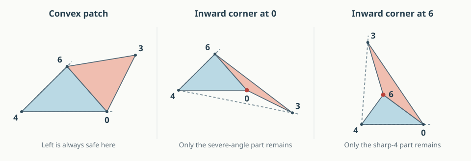

# N7-A992: a proved split of the first obstruction

12 September 2026. **Conditional geometric theorem; the whole graph remains open.**
A subsequent [repair lemma](A992_R0.html) closes the E/135 obligation in R0,
and a [base-edge extension](A992_BASE_EDGES.html) settles E/235 in its
converging and parallel subcases.
This argument proves that the Left unfolding works except in two explicitly
described regimes. It does not yet prove that Right repairs those regimes.
No sampling or interval certificate is a premise of the theorem.

[Return to the illustrated A992 case](A992.html#cone-progress) ·
[Seven-vertex graph map](index.html#N7-A992)

## What the result says, in pictures and words {#meaning}

Join triangles 046 and 036 along their common edge 06 and flatten them. Call
this two-triangle patch **H**. It can be convex, or it can have one inward
corner, at 0 or at 6. It cannot have both inward corners. This classification
is about the flattened patch; the spatial polyhedron is always convex.

<figure><figcaption>Three possibilities for the same two-face patch. Blue is triangle 046; coral is E = 036. These are explanatory planar sketches, not three certified spatial realizations. Dashed rays show the enclosing cone at vertex 4.</figcaption></figure>

Left can only fail by putting E through Q. The proof below confines that
failure much further:

| Flattened patch | What is now proved | What can still fail |
| --- | --- | --- |
| Convex | Left works, with no extra hypothesis | Nothing in this branch |
| Inward corner at 0 | Left works if $2\kappa_0+2q_0+\kappa_4\ge\pi$ | Only a very severe inward corner: its patch angle exceeds $270^\circ+\kappa_4/2$ |
| Inward corner at 6 | Left works if $\angle430\le90^\circ$ or $\angle246+\angle640\ge90^\circ$ | Only if both tests fail; this forces $\kappa_4>180^\circ$ |

Here $q_0$ is Q's angle at 0. Curvature $\kappa_x$ means $360^\circ$ minus
the sum of the original face angles at vertex $x$. A larger curvature means
less surface angle around that vertex. Formulas use radians.

There is a useful separation between the two unresolved regimes. The first
requires **$\kappa_4<\pi$**, the second **$\kappa_4>\pi$**. In particular,
**every realization with $\kappa_4=\pi$ is settled by Left**. These are exact
conditional statements, not percentages of the possible shapes.

## Definitions and theorem {#theorem}

Use the face names and original-edge cut lists on the [case page](A992.html).
The only pair needing proof in Left is $Q/E$. Its relative placement is
unchanged when the pentagon P is replaced by its internal triangle 246,
by the [localization lemma](A992.html#localization). We may therefore work
with the quadrilateral pyramid on vertices 0, 2, 3, 4, 6.

An angle $\angle ijk$ is at its middle vertex $j$. Set

$$e_0=\angle406+\angle603,\qquad
  e_6=\angle460+\angle063,$$
$$q_0=\angle403,\quad q_4=\angle042,\quad
  \omega=\angle640,\quad \tau=\angle246,\quad h=\omega+\tau,$$
$$\beta=\angle430,\qquad
  \kappa_0=2\pi-e_0-q_0,\qquad
  \kappa_4=2\pi-q_4-h.$$

The segment 43 is an internal diagonal of Q, used only to compare lengths
and angles. It is never cut. The curvatures at 0 and 4 equal those in the
original seven-vertex polyhedron: all sectors at those vertices are unchanged.

**Theorem.** Left has disjoint face interiors under any of these conditions:

1. $e_0\le\pi$ and $e_6\le\pi$.
2. $e_6>\pi$, and either $\beta\le\pi/2$ or $h\ge\pi/2$.
3. $e_0>\pi$, and $2\kappa_0+2q_0+\kappa_4\ge\pi$.

Consequently an actual Left failure satisfies exactly one of the following
necessary alternatives:

$$\boxed{\text{R0: } e_0>\pi,\quad
      2\kappa_0+2q_0+\kappa_4<\pi,}$$
$$\boxed{\text{R6: } e_6>\pi,\quad
      \beta>\pi/2,\quad h<\pi/2.}$$

A shape satisfying R0 or R6 need not fail. These are the only places a
failure can occur, not a characterization of all failures.

## Proof: a fan with two end pieces {#fan}

Develop the faces at 4 in order

**triangle 046 → triangle 246 → Q**, across hinges **46 and 24**.

Place 4 at the origin and the first copy of edge 40 on the positive
horizontal ray. Choose the development to turn counterclockwise. Triangle
046 lies in the angular sector $[0,\omega]$, triangle 246 in
$[\omega,h]$, and the convex quadrilateral Q in

$$[h,\Gamma_4],\qquad \Gamma_4=q_4+h=2\pi-\kappa_4<2\pi.$$

The strict spherical triangle inequality at each trihedral vertex gives

$$q_4<h,\qquad q_0<e_0.$$

For clarity, these inequalities compare the angles between three original
edge rays. The direct spherical distance between two rays is smaller than
the route through the third, since the three rays are linearly independent.
All individual face angles are less than $\pi$. Positive curvature is the
usual strict angle defect at a vertex of a convex three-dimensional polytope.

Attach E to triangle 046 on the other side of hinge 06. The resulting
patch H is simple: its two triangular interiors lie in opposite half-planes
of the hinge line. Its corners at 4 and 3 are less than $\pi$, while the
other two corners have angles $e_0,e_6$. The quadrilateral angle sum shows
that at most one of them exceeds $\pi$.

If neither does, H is convex. It is contained in the sector at its vertex 4,
namely $[0,\omega]$. Q lies in $[h,\Gamma_4]$, with $h>\omega$ and a
positive slit gap $\kappa_4$. The interiors are disjoint. This proves part 1,
including a straight corner of H.

## Proof: the inward corner is at 6 {#corner-six}

Now suppose $e_6>\pi$, so $e_0<\pi$. Let $3'$ denote the copy of vertex 3
in E. Vertex 6 is inside triangle $4,0,3'$, and H is contained in that
triangle. Its enclosing cone at 4 is $[0,\gamma]$, where
$\gamma=\angle0\,4\,3'$ is between 0 and $\pi$.

Compare this triangle with the spatial triangle 403 inside Q. Write

$$r=|40|,\qquad s=|03|,\qquad D=|43|,\qquad t=|4\,3'|,
\qquad \alpha=\angle043.$$

The angle at 0 in the developed triangle is $e_0$; in the spatial triangle
it is $q_0$. Since $q_0<e_0<\pi$, the cosine law gives **$t>D$**. Also
$0<\alpha<q_4$, because diagonal 43 is strictly inside Q's angle at 4.
For a variable opposite distance $t$, the angle at 4 satisfies

$$\cos\gamma(t)=\frac{r^2+t^2-s^2}{2rt},\qquad \gamma(D)=\alpha.$$

If $\beta\le\pi/2$, the cosine law at 3 gives $D^2+s^2-r^2\ge0$.
Hence

$$\cos\gamma(t)-\cos\gamma(D)
  =\frac{(t-D)(tD-r^2+s^2)}{2rtD}\ge0.$$

Indeed the first factor is positive, and the second is at least
$D^2-r^2+s^2$. Therefore $\gamma\le\alpha<q_4<h$. The enclosing cone of
H stops before Q starts.

If instead $\beta>\pi/2$, then $r^2>D^2+s^2>s^2$. The numerator in the
formula for $\cos\gamma(t)$ is positive, so $\gamma<\pi/2$. When
$h\ge\pi/2$, its cone again stops before Q starts. This proves part 2.
There is no extension across the slit ray in this branch.

## Proof: the inward corner is at 0 {#corner-zero}

Suppose $e_0>\pi$ and put

$$\rho=e_0-\pi=\pi-\kappa_0-q_0,\qquad 0<\rho<\pi.$$

H is now contained in triangle $4,3',6$. Relative to the positive ray 40,
its enclosing cone is $[-B,\omega]$ for some $0<B<\rho$. To see the latter
bound, triangle $4,0,3'$ has angle $\pi-\rho$ at 0, and its other two
angles are positive. Thus its angle $B$ at 4 is less than $\rho$.

If $B\le\kappa_4$, the cone of H does not enter the interior of Q's sector,
so we are done. It remains to consider $B>\kappa_4$, which in particular
implies

$$0<\kappa_4<\rho<\pi.$$

The following line separation settles that remaining possibility under the
theorem's hypothesis. Write $r=|40|$ and let the two developed copies of 0 be

$$A=(r,0),\qquad A'=r(\cos\kappa_4,-\sin\kappa_4).$$

The cut edge from $A$ to $3'$ points in direction

$$d=(\cos\rho,-\sin\rho).$$

The interior of E lies strictly to the **left** of this oriented line.
We will put Q to its right. First, the signed position of its corner $A'$ is

$$\det(d,A'-A)
 =-2r\sin(\kappa_4/2)\cos(\rho-\kappa_4/2).$$

The assumed inequality is equivalent to

$$\rho\le\frac{\pi+\kappa_4}{2}.$$

Together with $\rho>\kappa_4$, this puts
$\rho-\kappa_4/2$ in $(0,\pi/2]$, so the determinant is nonpositive.
Thus $A'$ is on or to the right of the line.

Every direction from $A'$ into Q lies in its corner sector of width $q_0$.
Relative to $d$, with a consistent choice of angles, this sector is

$$[\rho-\pi-\kappa_4,\ \rho+q_0-\pi-\kappa_4]
 =[\rho-\pi-\kappa_4,\ -\kappa_0-\kappa_4]
 \subset(-\pi,0).$$

The left endpoint exceeds $-\pi$ because $\rho>\kappa_4$; the right
endpoint is negative because the curvatures are positive. Every such
direction therefore points strictly to the right of the line. Starting
from $A'$ already on or to its right, every other point of Q is strictly
on the right. Q and E have disjoint interiors, even in the equality case
of the theorem. This proves part 3.

All other face pairs in Left are universally safe by the earlier
[cofacial-core and pair arguments](ARGUMENTS.html#cofacial-core).
In particular, the six faces other than E form the neighborhood of P,
covered by [Pinciu's face-neighborhood theorem](https://cccg.ca/proceedings/2007/01a4.pdf).
Thus settling this last pair settles the whole Left net. □

## What a failure now forces {#consequences}

In R0, substituting $\kappa_0=2\pi-e_0-q_0$ gives

$$e_0>\frac{3\pi+\kappa_4}{2}>\frac{3\pi}{2}.$$

Both constituent angles $\angle406$ and $\angle603$ are less than $\pi$,
so each must exceed $\pi/2$. In particular,

$$|46|^2>|40|^2+|06|^2,\qquad
  |36|^2>|03|^2+|06|^2.$$

The same regime has $\kappa_4<\pi$, directly from its defining strict
inequality and $\kappa_0,q_0>0$.

In R6, $q_4<h<\pi/2$, so

$$2\pi-\kappa_4=q_4+h<\pi,\qquad\text{hence }\kappa_4>\pi.$$

These opposite curvature requirements prove that the two possible failures
are disjoint, and neither includes $\kappa_4=\pi$.

## The remaining proof target {#remaining}

The two-attachment conjecture now has a more concrete starting point:
**assume actual Q/E overlap in Left, and split into R0 and R6**. In each
regime, Right still needs E separated from Q, 135, and 235. This gave six
conditional statements to investigate at the cone-proof stage. The subsequent
[obtuse-petal argument](A992_R0.html) proves E/135 in R0. The other five
remain open. These are not equal portions of the realization space.

R0 supplies two strict squared-length inequalities and a severe lower bound
on the inward angle. R6 supplies a vertex of curvature greater than $\pi$.
These are geometric constraints with which to try a repair proof, rather
than an unconstrained search over all eleven parameters.

This reuses the cone and cut-edge separation ideas from the earlier
six-vertex work, with the constants and hypotheses rederived here. It does
not assume that the complete six-vertex theorem automatically extends to
seven vertices. The proof is written for review; it is not Lean formalized.

## The sharp-4 obstruction really occurs {#r6-example}

The second regime is not just a logical possibility. A new rational example
has an inward corner at 6, $\beta>\pi/2$, $h<\pi/2$, and strict Q/E overlap
in Left. Right works on that same example. Its eleven parameters are

$$(-4.8315,\ .1459,\ -3.221,\ .0968,\ -1.6105,\ .0481,
\ -1.5034,\ .4183,\ .0169,\ 4.5409,\ .1761).$$

The [exact certificate](results/a992-corner-six-counterexample.json) checks
all facets and corners, a rational point strictly inside Q and E, and three
strict separators for Right. It also checks membership in R6 without using
rounded angles: the developed patch has a strictly inward turn at 6;
$(p_4-p_3)\cdot(p_0-p_3)<0$ proves $\beta>\pi/2$; and both $\sin h$ and
$\cos h$ have strictly positive numerators. Since $0<h<2\pi$, the latter
two signs prove $h<\pi/2$.

Specifically, put $u=p_2-p_4$, $v=p_6-p_4$, $w=p_0-p_4$, and
$A=u\cdot v$, $B=v\cdot w$, $C=|u\times v|$, $D=|v\times w|$.
The numerators are $AB-CD$ and $CB+AD$, with a common positive denominator.
The certificate bounds these expressions with outward rational arithmetic.
This is an exact single-shape result; it is not a proof that Right repairs
all of R6. Run `python3 -B -m n7.a992_exact` to replay it with the earlier
certificates.
