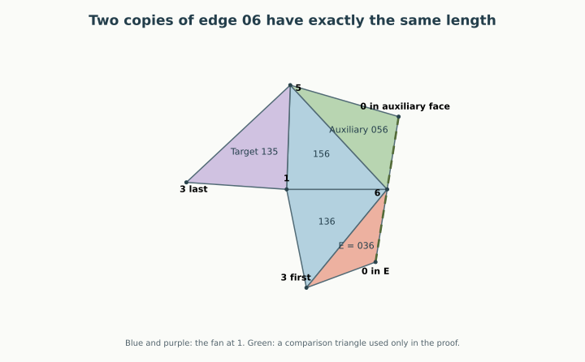

# N7-A992: one repair obligation is now proved

**Written geometric proof, 12 September 2026.** In the severe inward-corner
regime R0, Right keeps triangle E = 036 disjoint from triangle 135.
The whole graph remains open: Right versus Q and Right versus 235 still
need proofs in R0, and the three R6 obligations remain open.

[Back to the illustrated case](A992.html#next-lemma) ·
[The earlier cone split](A992_CONES.html) ·
[Seven-vertex overview](index.html#N7-A992)

## What changed {#result}

The first attachment's possible failures were already confined to R0 and
R6. R0 forces both angles at vertex 0 in triangles 046 and 036 to be obtuse.
We can now use just one of those consequences:

> **Obtuse-petal theorem for A992.** If $\angle603\ge\pi/2$, then in Right,
> E = 036 and triangle 135 have disjoint interiors.

This includes every realization in R0, whether or not Left actually fails.
It is a proof for a whole geometric family, not a certificate for a sample.
Equality at $\angle603=\pi/2$ is included.

| Repair obligation | R0 | R6 |
| --- | --- | --- |
| E avoids Q | Open | Open |
| E avoids 135 | **Proved** | Open |
| E avoids 235 | Open | Open |

Thus **one of the six conditional pair statements is closed**. This is a
count of statements, not a percentage of the possible shapes or of the
work remaining. Right now has 19 of its 21 face pairs settled throughout
R0; the corresponding unrestricted count is still 18 of 21.

## Why five vertices are enough {#localization}

The hinge path controlling this pair in Right is

**E = 036 → 136 → P → 135**, across **36, 16, and 15**.

Replace P by its internal triangle 156. Both hinges remain in the same
relative position, so the E/135 placement is unchanged. Vertices 2 and 4
play no role in this pair.

The convex hull of **0, 1, 3, 5, 6** is a triangular bipyramid. Its six faces
are

$$V_0=036,\quad V_1=065,\quad V_2=053,\qquad
  W_0=136,\quad W_1=165,\quad W_2=153.$$

The poles are 0 and 1; its equator is the triangle 356. The four faces
$V_0,W_0,W_1,W_2$ are the original strictly supporting faces, with P
restricted to triangle 156. At 1, the latter three already form a complete
trihedral neighborhood, so 01 is not an edge. All five retained vertices
are still extreme. Also 0, 3, 5, 6 are not coplanar, since original face 036
supports vertex 5 strictly. The remaining hull facets are consequently
035 and 056, completing the bipyramid. This establishes the auxiliary
polyhedron from the original convexity assumptions, rather than assuming
an arbitrary collection of triangles is convex.

Unfold its fan $W_0,W_1,W_2$ at vertex 1, with slit 13, and attach $V_i$
along each equator edge. The restriction to $V_0,W_0,W_1,W_2$ is the
required Right placement. We will use $V_1=056$ as a comparison triangle.
It is an internal auxiliary face in the original solid, not an added cut
or face in the final seven-vertex net.

<figure><figcaption>An illustrative triangular bipyramid for the general lemma, with an obtuse angle at 0 in E. This is a separate metric example, not the seven-vertex counterexample. The green face is used only for comparison. If overlap occurred in the difficult branch, it would trap the green face and contradict the equality of the two highlighted lengths.</figcaption></figure>

## Notation and two elementary facts {#setup}

For the rest of the proof abbreviate

$$w=1,\quad a=3,\quad c=6,\quad d=5,\quad v=0.$$

Then $V_0=vac$, $V_1=vcd$, $V_2=vda$, and $W_0=wac$, $W_1=wcd$,
$W_2=wda$. The target is $V_0/W_2$.
Let $\nu=\angle avc\ge\pi/2$, and let $\omega_i$ be $W_i$'s angle at w.
Write $\Gamma_x=2\pi-\widehat\kappa_x$ for angle sums and curvatures in
this **auxiliary bipyramid**. Its curvature at 1 equals the original
curvature there; no such identification is needed at the other vertices.

Two elementary convexity facts will be used. First, consecutive incident
faces joined around a vertex develop into sectors with disjoint interiors:
their total angle is less than $2\pi$. This proves, among others,

- $V_0$ avoids $W_1$ and $V_1$, by their uncut paths through c;
- $V_1$ avoids $W_2$, by their uncut path through d;
- all three fan faces avoid each other.

Second, a convex spherical link has the strict side inequality
$2\eta<\Gamma_x$ for each face angle $\eta$ at x. If a nonadjacent vertex
direction lies inside the link, the distance from an edge direction to it
is less than the boundary route obtained by omitting either link side
incident to that edge direction. To see this, extend the great-circle ray
through the interior direction until it exits the link. Its exit lies on
the remaining boundary route, whose length is greater than the distance
to the original interior point. The link lies in an open hemisphere, so
these are unambiguous shortest spherical distances.

## 1. A convex patch, or an inward corner beside the slit {#easy}

Join $V_0$ and $W_0$ along ac. This is a simple two-triangle patch. Let its
corners at a and c be $e_a,e_c$. At most one is greater than $\pi$.
If both are at most $\pi$, the patch is convex and lies in $W_0$'s sector
at w, which is disjoint from $W_2$'s sector.

Suppose next that $e_a>\pi$, an inward corner beside the slit. Its excess
satisfies

$$\rho=e_a-\pi<\angle vac<\pi/2,$$

because $W_0$'s angle at a is less than $\pi$, and the two other angles of
the triangle with angle $\nu\ge\pi/2$ are strictly acute.
The patch extends backward across ray wa by an angle $B$ with
$0<B<\rho$. If $B\le\widehat\kappa_w$, the slit gap separates it from
$W_2$.

Otherwise put $r=|wa|$, the first a-copy at $A=(r,0)$, and the last at
$A'=r(\cos\widehat\kappa_w,-\sin\widehat\kappa_w)$. The cut edge from
A to the developed v-copy has direction $u=(\cos\rho,-\sin\rho)$;
$V_0$ lies strictly to its left. But

$$\det(u,A'-A)=-2r\sin(\widehat\kappa_w/2)
                  \cos(\rho-\widehat\kappa_w/2)<0,$$

since $0<\widehat\kappa_w<B<\rho<\pi/2$.
Let $q$ and $\mu$ be the angles at a of $W_2$ and $V_2$. The vertex-angle
identity says $\rho=\pi-\widehat\kappa_a-q-\mu$. Relative to u, the
corner sector of $W_2$ at $A'$ is

$$[\rho-\pi-\widehat\kappa_w,\
   \rho+q-\pi-\widehat\kappa_w]
 =[\rho-\pi-\widehat\kappa_w,\
   -\widehat\kappa_a-\mu-\widehat\kappa_w]\subset(-\pi,0).$$

Thus every direction into $W_2$ points to the right of the same line,
starting from $A'$ already strictly on its right. This separates the pair.

## 2. Inward at c, with a fan of angle at least pi {#wide-fan}

It remains to treat $e_c>\pi$. Let P be the developed v-copy in $V_0$.
The patch is contained in triangle waP, with c strictly inside it. Write
$\gamma=\angle awP$ for its full outer angle at w, and compare it with
triangle wav in space:

$$r=|wa|,\quad s=|av|,\quad D=|wv|,\quad t=|wP|,
\quad \alpha=\angle awv,\quad\beta=\angle avw.$$

Here $e_a<\pi$ and the spherical triangle inequality at a gives
$\angle wav<e_a$, hence $t>D$ by the cosine law. If $\beta\le\pi/2$,

$$\cos\gamma(t)-\cos\gamma(D)
 =\frac{(t-D)(tD-r^2+s^2)}{2rtD}\ge0,$$

so $\gamma\le\alpha$. Since v is strictly inside w's spherical link,
the omitted-side bound gives
$\alpha<\Gamma_w-\omega_2=\omega_0+\omega_1$. The patch's cone therefore
stops before $W_2$ starts.

If $\beta>\pi/2$, then $r^2>D^2+s^2>s^2$, so
$\cos\gamma(t)=(r^2+t^2-s^2)/(2rt)>0$ and $\gamma<\pi/2$.
When $\Gamma_w\ge\pi$, the link side inequality gives
$\Gamma_w-\omega_2>\Gamma_w/2\ge\pi/2$, which again separates the cones.
This includes the equality $\Gamma_w=\pi$.

## 3. The narrow-fan case: overlap would trap a second copy of v {#containment}

We are left with $e_c>\pi$ and $\Gamma_w<\pi$. Suppose that
$\operatorname{int}(V_0)$ and $\operatorname{int}(W_2)$ overlap. Choose a
point p in their intersection, avoiding the finitely many lines through
vertices that would cause collinearities below.

Let M be the developed v-copy in $V_1$. At their common c, put

$$\theta=\angle wcd+\angle dcv,\qquad k=\widehat\kappa_c,
\qquad s=|cv|.$$

Starting at cw and turning toward the middle patch, the cyclic order is

**cw, cd, cM, cP, ca**,

with the gap from cM to cP equal to k. The first four rays lie in the
closed half-plane containing the middle patch; ca lies on the other side
of line cw. The angle identity gives
$e_c+\theta=2\pi-k$, so $0<\theta<\theta+k<\pi$.
The two developed lengths satisfy **$|cM|=|cP|=s$**.

Consider the ordinary triangle $S=\operatorname{conv}\{w,c,p\}$.
We claim that the entire middle patch $W_1\cup V_1$ is contained in S.
Here are the boundary checks that justify this claim:

1. Since the whole fan angle is below $\pi$, p is on the middle patch's
   side of line wc. The fan direction wd lies strictly between wc and wp.
   Thus an interior part of $W_1$ near w is inside S.
2. The open segment cp is inside $V_0$, which avoids $W_1$. The ray wp
   is beyond $W_1$'s angular sector. The third boundary wc is its own edge.
   Therefore the connected triangular interior of $W_1$ cannot leave S.
   In particular d, whose ray is strictly between wc and wp, is inside S.
3. An interior part of $V_1$ near its hinge cd is consequently inside S.
   It cannot cross cp, because it avoids $V_0$. It cannot cross wp,
   whose open finite segment is inside $W_2$, because it avoids $W_2$.
   It cannot cross line wc: its total corner with $W_1$ at c is
   $\theta<\pi$, so the whole patch lies on the same side of that line.
   Thus $V_1$ cannot leave S either.

These arguments concern interiors of nondegenerate triangles. A point of
one triangle's boundary lying in another's interior would also create
interior overlap nearby; hence such contacts do not provide an escape.
Closed containment is enough for the following calculation. In particular,
**M lies in S**, on c's side of the line wp.

## 4. Equal lengths contradict an obtuse petal angle {#identity}

Use coordinates $c=(0,0)$ and $w=(r,0)$. With the ray order above,

$$M=s(\cos\theta,\sin\theta),\qquad
  P=s(\cos(\theta+k),\sin(\theta+k)).$$

Let $\delta=\angle cwp$. The ray wp intersects the interior of $V_0$ but
cannot meet its edge ca, which lies in the earlier fan sector $W_0$.
It therefore meets the open edge cP at some $q=tP$, $0<t<1$.
The point q may be before or after p on that ray; the argument needs only
that q lies strictly between c and P.
The triangle cwq gives

$$0<\theta+\delta<\theta+k+\delta<\pi.$$

A direction along wp is $u=(-\cos\delta,\sin\delta)$. Collinearity of q
and closed containment of M yield, respectively,

$$r\sin\delta=t s\sin(\theta+k+\delta)
                 <s\sin(\theta+k+\delta),$$
$$\det(u,M-w)=r\sin\delta-s\sin(\theta+\delta)\ge0.$$

Consequently $\sin(\theta+k+\delta)>\sin(\theta+\delta)$. The sine
difference formula, with its argument strictly between 0 and $\pi$, gives

**Overlap consequence (1):**

$$2\theta+2\delta+k<\pi.$$

Now let $\epsilon=\angle vac$ be $V_0$'s angle at a, let
$\zeta=\angle acv$ be its angle at c, and let
$\eta=\angle acw$ be $W_0$'s angle at c. Put
$L=\Gamma_c-2\eta>0$, the strict spherical-link slack for $W_0$ at c.
The face and vertex identities are simply

$$\nu+\epsilon+\zeta=\pi,\qquad
  \Gamma_c=\eta+\zeta+\theta,\qquad k=2\pi-\Gamma_c.$$

They give the following **exact identity (2)**:

$$\boxed{2\theta+2\delta+k-\pi
       =L+(2\nu-\pi)+2\epsilon+2\delta>0.}$$

Every term on the right is nonnegative, with L, $\epsilon$, and $\delta$
strictly positive, because $\nu\ge\pi/2$. This contradicts (1).
It settles the narrow-fan branch and completes the theorem. □

## Scope and next step {#scope}

The proof used only a convex triangular bipyramid and an angle of at least
$\pi/2$ at one pole in the chosen petal. It proves that petal is disjoint
from the opposite fan face for the stated slit; the other two fan faces
are already safe by shared-vertex paths. It does **not** prove that all
petals of an arbitrary triangular bipyramid are mutually disjoint.

For A992, the auxiliary hull is a comparison only. The final net remains
Right with cuts **03, 04, 06, 13, 23, 35**. No new diagonal is cut.
R0 has $\angle603>\pi/2$, so this closes its E/135 obligation outright.
The next targets are E/Q and E/235; no universal conclusion about either
is being inferred from this proof.

The equal-copy containment idea is related to the earlier six-vertex
chord argument, but the local containment premises and the new positive
identity are established above. The n6 theorem and its Lean files are not
modified or assumed as black boxes.

The identity was found with linear exploration of angle constraints and
then reduced to the three displayed equations. Its proof is that algebraic
expansion and positivity, not the outcome of the optimizer. Numerical
searches used during discovery are retained separately and are not proof
premises. This is a written research argument with a boundary audit, not a
Lean formalization or an independently reviewed proof.

The [integer coefficient check](results/a992-r0-angle-identity.json) expands
the final identity exactly. Run `python3 -B -m n7.r0_identity` to replay it.
This verifies the algebraic step; the containment and convexity arguments
remain the written geometric proof above.

## An exact example in the difficult branch {#example}

The narrow-fan branch is not empty even in the original seven-vertex problem.
The [new rational certificate](results/a992-r0-narrow-fan-example.json) verifies
one shape where Left has strict Q/E overlap, its first patch is inward at 0,
and the Right patch is inward at 6 while the fan angle at 1 is below $\pi$.
All three residual Right pairs are strictly separated on that shape.

The branch checks use signed dot products, developed corner determinants,
and the positive sine of the fan-angle sum, enclosed by outward rational
intervals. Convexity gives a fan sum in $(0,2\pi)$, so a positive sine proves
it lies below $\pi$. Left overlap together with its inward corner at 0
identifies R0 by the earlier cone theorem. Run `python3 -B -m n7.r0_examples`
to replay every sign. The example exercises the proof; it is not its premise.
