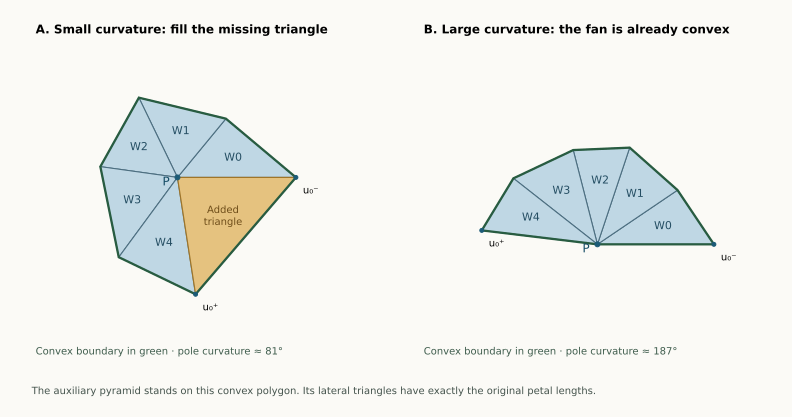

# Aligned poles: one fixed tree works throughout the insertion

**13 September 2026 · A proved geometric family, for any equator size.**
Let a convex polygon lie in a plane, and let its two poles lie on the same
perpendicular line through an interior point of that polygon. The poles
may have different heights. Every such bipyramid has an edge unfolding
by the following rule:

> Use the lower-height pole as the fan center. Cut all edges at the
> higher-height pole. Add one cut from the fan center to a farthest
> equator vertex.

This is an entire geometric family, including examples with four inward
patches and both pole curvatures very small. It does **not** cover arbitrary
pentagonal bipyramids: their equator need not be planar, and their poles
need not line up this way.

[Overview](index.html#bipyramid) · [Large-pole proof](BIPYRAMID_STAR_PATCH.html) ·
[General equator-insertion route](BIPYRAMID_MORPH.html)

## A six-to-seven-vertex construction that really preserves a net {#insertion}

For a pentagonal equator, keep the higher pole fixed. Initially there is
just a pentagonal pyramid, with six vertices. Choose the point in its base
directly opposite the apex, and raise a new pole from that point on the
other side of the base. Stop before the new pole becomes taller than the
old one.

**One fixed cut tree works for the entire insertion.** The new pole starts
with zero curvature and acquires positive curvature. The slit is always
at the equator vertex farthest from the common projection of the poles;
that vertex does not change as the new pole rises.

The proof is by comparison with a convex pyramid at every stage. It does
not rely on sampling heights or on assuming that a successful initial net
will remain successful by continuity.

[Move the new pole yourself: interactive 3D solid and net](bipyramid-aligned-demo.html).

## 1. Exact setting and rule {#theorem}

Let $A=u_0\cdots u_{m-1}$ be a strictly convex planar polygon, $m\ge3$,
and $c$ a point strictly inside it. Choose coordinates with its plane
$z=0$ and put

$$p=(c,h),\qquad q=(c,-H),\qquad 0<h\le H.$$

The convex hull has the $2m$ genuine triangular facets

$$W_i=p u_i u_{i+1},\qquad V_i=q u_i u_{i+1}.$$

Height means distance from the equator plane. No regularity of the
polygon and no equality of the heights is required.
Choose $u_k$ maximizing $|p u_i|$ and cut

$$T=\{q u_i:0\le i<m\}\cup\{p u_k\}.$$

Ties may be resolved arbitrarily. This is an original-edge spanning tree.
The $W_i$ form the opened fan; $V_i$ is its petal on the corresponding
equator edge. We prove that this entire net has disjoint face interiors.

Write $P$ for the single developed image of the fan center $p$. The
opened fan has angle

$$\Gamma=2\pi-\kappa_p\in(0,2\pi).$$

Its boundary goes from $P$ to a first copy $U_k^-$ of the slit vertex,
along the whole equator chain, to the second copy $U_k^+$, and back to
$P$. The chain has $m+1$ vertices because its two endpoints represent
the same original vertex.

## 2. Why the fan boundary is convex away from its center {#boundary}

Reflect the cap at $p$ across the plane of $A$. Together the two congruent
caps form a convex bipyramid with poles $(c,h),(c,-h)$. At an equator
vertex, the two cap angles are equal and their sum is strictly less than
$2\pi$, because that vertex has positive curvature. Thus the angle of
our original fan boundary at every uncut equator vertex is strictly less
than $\pi$.

This reflection is only used to establish a fact about the lower cap.
The actual opposite cap may have height $H>h$.

At the chosen slit vertex, both incident fan-triangle base angles are
strictly acute. Indeed, if $r=|p u_k|\ge |p u_j|=s$ for an adjacent
vertex and $L=|u_k u_j|>0$, the cosine rule gives

$$\cos\angle p u_k u_j=\frac{r^2+L^2-s^2}{2rL}>0.$$

The opened fan is a simple planar disk. Its triangles occupy successive
angular wedges of total angle $\Gamma<2\pi$, with only their common
radial edges identified. These facts justify the following convex completion.

## 3. Complete the fan to a convex polygon {#completion}

### If the pole curvature is below $\pi$

The missing gap between $PU_k^+$ and $PU_k^-$ has angle
$\kappa_p<\pi$. Fill it with the isosceles triangle

$$\Delta=\operatorname{conv}(P,U_k^-,U_k^+).$$

It lies in the gap, so its interior misses the fan. The two copies of the
slit vertex are at the same distance from $P$; therefore each base angle
of $\Delta$ is $(\pi-\kappa_p)/2$.

Call the completed polygon $B$. The point $P$ becomes an interior point,
since the fan and added triangle give it total angle $2\pi$. At either
slit endpoint, the new boundary angle is an acute fan angle plus
$(\pi-\kappa_p)/2$, hence is strictly below $\pi$. All the other
boundary corners were already strictly convex. The simple polygon $B$
is consequently convex.

### If the pole curvature is at least $\pi$

Now $\Gamma\le\pi$. The fan itself is a convex polygon: its angle at
$P$ is at most $\pi$, and every other corner is below $\pi$. Take
$B$ to be this fan. Here $P$ lies on the boundary of $B$. No gap triangle
is added.

The case $\kappa_p=\pi$ is included: $P$ is a straight boundary point
and may be omitted from the polygon's vertex list. In this high-curvature
branch any slit gives a convex fan; the farthest-vertex choice is needed
only to guarantee the low-curvature completion.

## 4. An auxiliary pyramid has exactly the right petals {#comparison}

The two pole distances to every equator vertex differ by the same
quantity when squared:

$$|q u_i|^2-|p u_i|^2=H^2-h^2=:C\ge0.$$

Unfolding the lower fan preserves $|p u_i|=|P U_i|$, including both
copies of the slit vertex. Above the planar polygon $B$, construct a
pyramid with apex

$$X=(P,\sqrt C).$$

First suppose $C>0$. Its lateral triangle on an original equator edge
$U_iU_{i+1}$ has lengths

$$|XU_i|=\sqrt{|PU_i|^2+C}=|q u_i|,\qquad
|XU_{i+1}|=|q u_{i+1}|.$$

Its third edge has the original equator length. By side-side-side
congruence, it is exactly the original petal $V_i$. When opened outward
from the base, its planar placement is the original petal's placement
on the opened fan: it shares the same hinge and lies on the opposite
side of it from the fan triangle.

Every apex-to-base-vertex edge of the auxiliary pyramid is a shortest
surface path, since it realizes the Euclidean distance. Cutting all of
these edges is a point-source star unfolding, whose interior is
nonoverlapping. The base stays intact and all lateral triangles attach
to its outside. This uses the published point-star theorem, for example
Kiazyk–Lubiw, Section 2, Theorem 4 in
[*Star Unfolding from a Geodesic Curve*](https://drops.dagstuhl.de/entities/document/10.4230/LIPIcs.SOCG.2015.390).

Our entire original net is a subset of that safe arrangement:

- In the low-curvature branch, discard the added gap triangle from the
  auxiliary base, and discard the lateral triangle on its new closing edge.
- In the high-curvature branch, retain the fan base and the lateral
  triangles on the original equator chain; discard any auxiliary triangles
  on the slit-side boundary edges.

Taking a subset cannot create an interior overlap. This proves the
claimed edge unfolding when the heights differ.

The construction remains valid when $P$ is on the boundary of $B$.
A pyramid may have its apex directly above a boundary point of its base.
Its base and genuine lateral faces are still convex-polyhedron faces,
and its apex-to-base-vertex edges remain shortest paths. A straight point
in a polygon side can simply be omitted from its list of vertices.

### Equal heights and the zero-height comparison

If $H=h$, then $C=0$ and the auxiliary pyramid is flat. We justify this
case by genuine pyramids with the same base $B$ and apex $(P,\varepsilon)$,
where $\varepsilon>0$. Their safe lateral triangles converge to the
reflections of $\operatorname{conv}(P,U_i,U_{i+1})$ across their hinges.
Those are exactly the equal-height original petals.

If two of the limiting nondegenerate faces had an interior overlap,
a small open disk inside their intersection would persist for sufficiently
small positive $\varepsilon$, contradicting the star theorem. Extra
triangles that collapse along a boundary side may be discarded. All
original fan triangles and petals are nondegenerate. Thus the limiting
arrangement, and hence the original net, is safe. $\square$

This proof uses only an auxiliary pyramid and the published star theorem;
it does not depend on the six-vertex octahedron proof or its formalization.

## 5. The same tree works for a whole insertion, not just one solid {#morph}

Fix $A,c,H$, and a target height $h\le H$. Define

$$p(t)=(c,th),\qquad q=(c,-H),\qquad 0\le t\le1.$$

At $t=0$, $p(0)=c$ lies inside the base facet of the $(m+1)$-vertex
pyramid with apex $q$. It has zero curvature and is not a genuine vertex.
At every $t>0$, it becomes the new pole of a convex $(m+2)$-vertex
bipyramid. In particular $m=5$ gives the requested **six-to-seven** growth.

Since

$$|p(t)u_i|^2=|c-u_i|^2+t^2h^2,$$

the farthest equator vertex is independent of $t$. The higher pole also
stays $q$, and the auxiliary squared height stays nonnegative:

$$C(t)=H^2-t^2h^2\ge0.$$

The theorem therefore proves a safe unfolding with the **same labelled
cut tree** at every positive time. At zero, the fan is simply a
triangulation of the original base polygon, and the limiting layout is
its ordinary safe pyramid star net. The artificial slit to the flat point
opens by angle zero there.

The inserted curvature increases from zero. For example, the normal
cone at $p(t)$ is described, in upward normal directions $n$, by

$$n_{xy}\cdot(u_i-c)\le th\,n_z\quad\text{for every }i.$$

Because $c$ is interior to $A$, nonzero normals in this cone have $n_z>0$.
Increasing $t$ expands this cone; its spherical area, the vertex
curvature, increases. No assertion that curvature ordering alone protects
a net is being made: the auxiliary-pyramid comparison protects it here.

Scaling both pole heights from zero in a fixed ratio also preserves the
same tree for all positive scales, including the mirror-symmetric case.
That variant starts from a doubled polygon. The fixed-higher-pole version
above starts from a genuine six-vertex pyramid.

## 6. Connection with the earlier distance-sum rule {#rule}

For aligned poles, the earlier local rule becomes this whole-net rule.
The sum

$$\sqrt{|c-u_i|^2+h^2}+\sqrt{|c-u_i|^2+H^2}$$

is strictly increasing in $|c-u_i|$. Thus its maximizing slit is exactly
the farthest vertex selected here. Normal-cone expansion with height
also shows that the higher pole has at least as much curvature as the
lower pole. It is the sharper cut-star source in the earlier rule.

So this is a family on which the largest-distance-sum rule is now proved
to settle **all 45 face pairs** for a pentagonal bipyramid. For arbitrary
bipyramids, the earlier theorem still settles only the adjacent pairs.

The patch pattern itself is independent of the two heights. At a ring
corner the sign of the dot product with its base edge depends only on
$c$ and the polygon. Both cap angles are acute, right, or obtuse together;
their sum is below, equal to, or above $\pi$ accordingly. Raising the
poles can therefore pass through very different curvature regimes while
remaining in one symbolic patch class.

## 7. A four-inward example in the difficult low-curvature region {#four}

Take the following exact coordinates:

| Vertex | Coordinates |
| --- | --- |
| $u_0$ | $(-1504,-547,0)$ |
| $u_1$ | $(100,0,0)$ |
| $u_2$ | $(129,153,0)$ |
| $u_3$ | $(-69,394,0)$ |
| $u_4$ | $(-693,400,0)$ |
| $p$ | $(0,0,1)$ |
| $q$ | $(0,0,-1)$ |

The pattern is **CBBBB**. Both pole curvatures are approximately
$0.00992^\circ$. Its only convex patch has two acute ring corners, so
neither the large-pole theorem nor the shortest-patch obtuse-corner
condition applies. The aligned-pole theorem nevertheless gives a safe
net with slit $pu_0$, the farthest vertex. An unequal-height variant with
$q=(0,0,-6)$ is covered too.

This demonstrates that four inward patches with two low-curvature poles
are a real geometric possibility. The whole symbolic class is still open
when its realizations are allowed to leave the aligned-pole family.

## A certified neighborhood also allows nonplanarity and displaced poles {#nearby}

There is a separate exact result around the integer equal-height example
above. Allow **each of its 21 coordinates to vary independently by at most
$1/10000$**. Every point of that entire closed coordinate box is a genuine
convex pentagonal bipyramid with pattern CBBBB, and the same cut tree
$\{qu_i\}_{i=0}^4\cup\{pu_0\}$ is safe.

This box contains nonplanar equators and poles whose projections differ.
It is therefore not confined to the aligned-pole family. Both pole
curvatures stay below $1^\circ$; their computed interval bounds are much
smaller, approximately $0.00914^\circ$ to $0.01071^\circ$.

The [box certificate](results/bipyramid-four-bad-box.json) and
[its replay](bipyramid_four_bad_box.py) prove all 40 supporting-plane
inequalities uniformly over the box, retain the four inward patches, and
check all 45 face pairs of the selected net. Twenty-seven pairs are safe
by their shared uncut vertex paths; eighteen have strict separating axes
with positive outward interval bounds throughout the box.

This is an exact computational certificate for a full coordinate
neighborhood. It does not infer continuum safety from finite samples,
and it does not prove the whole CBBBB class. The aligned-pole theorem
covers an unbounded geometric family by a written proof; this additional
certificate covers a specified neighborhood, including nearby realizations
outside that family.

## What is solved and what is still open {#status}

| Geometric family | Status |
| --- | --- |
| Convex planar equator; poles perpendicular above/below the same interior point | **Proved**, any number of ring vertices and arbitrary positive heights |
| Insert the lower pole from zero curvature while the higher pole stays fixed | **Proved with one fixed tree**, throughout the full permitted height interval |
| Either pole curvature at least $180^\circ$, without alignment or planarity | **Proved separately** by shortest-patch replacement |
| Arbitrary pentagonal bipyramid with both poles below $180^\circ$ | **Open in general**; earlier local and patch-family results still apply |
| Arbitrary zero-curvature insertion chosen by minimum vertex curvature | **Open**; earlier exact failures show that a fixed initial tree can fail |

This family theorem does not change the whole-class count. With the
subsequent [radial theorems](BIPYRAMID_RADIAL.html), the current totals
are **10/34 graph types** and **6/15 symbolic classes** covered. This page
adds a theorem for an explicitly described geometric subfamily extending
across the symbolic partition, not a sampled percentage of shapes.

The [exact examples](results/bipyramid-aligned.json) and
[replay checker](bipyramid_aligned.py) verify seven rational instances:
unequal and equal heights, both convex-completion regimes, a near-flat
inserted pole, and the four-inward examples. They check supporting planes,
alignment, height order, the maximum-radius slit, the constant squared-distance
identity, convexity of the developed completion, and all 45 face pairs.
The all-height statement is the written proof, not an interpolation between
those finite examples. Independent mathematical review remains appropriate;
no Lean formalization is claimed.
