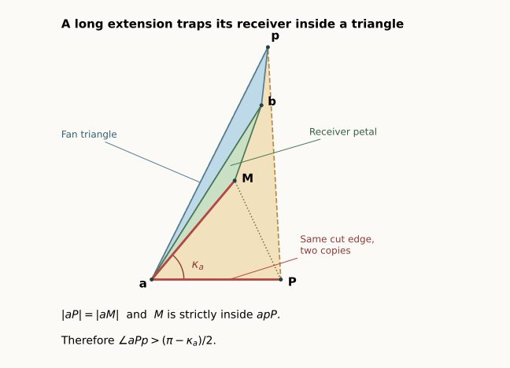

# Two bad patches facing across two convex patches: a complete rule

**Later progress:** the [radial receiver lemmas](BIPYRAMID_RADIAL.html) now give a shorter proof of this class and close two more classes. The current count is **6/15**. The angle-based proof below is preserved in full.

**13 September 2026 · Written proof of the entire opposing-chain class.**
The pentagonal bipyramid is still open, but one further complete pattern
is now covered: **FCCBC**, or **BCFCC** in the catalogue's canonical order.
There is no curvature-ranking, planar-equator, or alignment assumption.
The proof is elementary; the exact coordinate checks below verify examples
and do not stand in for the universal argument.

[Seven-vertex overview](index.html#bipyramid) ·
[All patch classes](BIPYRAMID_PATCHES.html) ·
[Earlier, now completed pair analysis](BIPYRAMID_CHAIN_PAIR.html)

## 1. What the rule does {#rule}

Flatten the two faces on each equator edge into a patch $Q_i$.
A convex patch stays inside the angle of its fan triangle. An inward
patch extends past one side of that angle. Write $\ell_i^p$ for the size
of that extension when $p$ is used as the fan pole.

The pattern considered here is

$$Q_0=F,\quad Q_1=C,\quad Q_2=C,\quad Q_3=B,\quad Q_4=C.$$

Thus $Q_0$ points forward into $Q_1$, and $Q_3$ points backward into
$Q_2$. They face one another across two convex receivers. The remaining
patch $Q_4$ is convex. Let $\omega_i^p$ be the angle of fan face $i$
at pole $p$.

**Theorem Chain.** Every convex pentagonal bipyramid with this pattern
has a nonoverlapping edge unfolding. The following finite rule supplies it.

1. Choose a pole $p$ such that
   $\ell_0^p+\ell_3^p<\omega_1^p+\omega_2^p$.
   At least one of the two poles satisfies this inequality.
2. An extension is **short** if it is at most its receiver's angle:
   $\ell_0^p\le\omega_1^p$ or $\ell_3^p\le\omega_2^p$.
   If both are short, use $p$ as fan.
3. Otherwise exactly one is long. Inspect the other pole $q$.
   If both extensions there are short, use $q$ as fan.
4. Otherwise keep $p$ as fan. The new lemma below proves that this last
   choice is safe too.

In every branch, cut all five edges at the **other** pole and the single
edge from the chosen fan pole to $u_0$. These six edges form a spanning
tree of the original graph. The rule never inserts a cut through a face.

Equality in a short-extension comparison is allowed. This is a mathematical
rule on the exact geometry; a finite-precision implementation may need
refinement or a separate equality treatment.

## 2. Why a long extension is useful information {#pocket}

The key point is that a long extension cannot have an arbitrary shape.
It forces its convex receiver into a triangular indentation.

**Long-receiver lemma.** Suppose an inward patch extends past the entire
fan angle of its adjacent convex receiver. Let $a$ be their shared equator
vertex, $p$ the fan pole, $q$ the other pole, and $\kappa_a$ the curvature
at $a$. Then

$$\ell_{\mathrm{bad}}^{q}>\frac{\pi-\kappa_a}{2},\qquad
\ell_{\mathrm{bad}}^{p}<\frac{\pi-\kappa_a}{2}.$$

Consequently the receiver's fan apex is acute. If $\lambda$ is the bad
petal's apex angle at its copy of $q$, then

$$\omega_{\mathrm{receiver}}^{p}<\frac\pi2,
\qquad \lambda<\frac{\pi+\kappa_a}{2}.$$

*This is a planar schematic of the proof, not a claimed coordinate
realization of the entire bipyramid.*

Here is the proof. Let $P$ be the copy of $q$ in the bad petal, and $M$
its copy in the convex receiver. Set $T=\operatorname{conv}\{a,p,P\}$.
This is the triangular indentation missing from the bad patch; it is
**not** the filled outer hull of that patch.

The receiver fan triangle begins inside $T$ at $p$. Its angular width is
less than the bad extension, so it cannot cross $pP$. Its other radial
side lies on $pa$. Crossing the remaining side $aP$ would overlap the
bad petal, impossible for faces in the same uncut fan at $a$: their
consecutive wedges have total angle $2\pi-\kappa_a<2\pi$.
Thus the receiver fan triangle lies in $T$.

Convexity of the full receiver confines its petal to the same angular
wedge at $p$. The same boundary argument therefore puts that petal in
$T$ as well. Its apex $M$ is strictly inside: the wedge excludes $pP$;
the receiver corner at $a$ is strictly less than $\pi$, excluding $pa$;
and the positive curvature gap excludes $aP$.

The two copied edges satisfy $|aP|=|aM|$. Their angular gap is
$\kappa_a$. The bad patch already uses more than $\pi$ of the total
angle at $a$, so $0<\kappa_a<\pi$. In the isosceles triangle $aPM$,

$$\angle aPM=\frac{\pi-\kappa_a}{2}.$$

Since $M$ is strictly inside $T$,
$\angle aPp>\angle aPM$. The angle $aPp$ is precisely the extension
$\ell_{\mathrm{bad}}^{q}$ obtained by viewing the same bad patch from the
other pole. This proves its lower bound.

Write $\eta$ for the bad corner minus $\pi$. The corner sum at $a$
says that the receiver corner is $\pi-\kappa_a-\eta>0$.
Since $\eta=\ell_{\mathrm{bad}}^{p}+\ell_{\mathrm{bad}}^{q}$, the other bound
follows. A long receiver has
$\omega_{\mathrm{receiver}}^{p}<\ell_{\mathrm{bad}}^{p}$, making its fan apex
acute. Finally $\lambda+\ell_{\mathrm{bad}}^{q}$ is an ordinary angle of
the bad patch's outer triangle, hence less than $\pi$. This proves the
bound on $\lambda$.

The argument also gives an obtuse **source** apex at the receiver; that
[earlier consequence](BIPYRAMID_CHAIN_PAIR.html#no-pocket) remains useful.
A straight corner at the receiver's other equator endpoint is harmless.
The shared endpoint $a$ is necessarily strictly convex on the receiver.

## 3. Reduction to one petal pair {#one-pair}

The full angle identities at $u_1,u_2,u_3$ give

$$\ell_0^p+\ell_0^q+\ell_3^p+\ell_3^q
=\omega_1^p+\omega_2^p+\omega_1^q+\omega_2^q
-\kappa_{u_1}-\kappa_{u_2}-\kappa_{u_3}.$$

The curvatures are strictly positive, so at least one pole satisfies
step 1. Both extensions cannot be long at that pole.

With slit $u_0$, the two bad cones are separated by the strict combined
inequality. Neither reaches $Q_4$ or extends across the slit. If both
extensions are short, each bad patch meets only its own receiver, and
those adjacent faces are safe by the uncut vertex fan.

Otherwise suppose $Q_0$ is long. Reflection handles $Q_3$. The extension
of $Q_0$ can reach $Q_2$, but cannot reach $Q_3$. All pairs are already
safe except $V_0/V_2$ and $V_0/W_2$, where $W$ denotes fan triangles
and $V$ the attached petals. Separating the petals also separates
$V_0/W_2$: every edge of $W_2$ borders a face already safe against
$V_0$, preventing $V_0$ from entering its interior.
The [full cone and boundary argument](BIPYRAMID_RECEIVERS.html#chain)
gives the details of this reduction.

The strict adjacent-receiver identity also gives

$$\ell_0^p+\ell_0^q<\omega_1^p+\omega_1^q.$$

Since $\ell_0^p>\omega_1^p$, the same bad patch is **strictly short**
at $q$. If $Q_3$ is short there too, step 3 is justified by the same
short-extension proof, without another combined-angle test.

The only remaining situation is therefore

$$Q_0\text{ long at }p,\qquad Q_3\text{ long at }q.$$

This is a real possibility, not a contradiction. The two long-receiver
lemmas will supply the two separate bounds that finish the proof.

## 4. The last pair always separates {#finish}

Use $p$ as fan. Develop the middle petal $V_1$ on base $a=u_1,b=u_2$,
with apex $M$. Write its base angles as $\phi,\psi$ and its apex angle
as $\nu$. The outer petals $V_0,V_2$ have apex copies $P,R$ and apex
angles $\lambda,\rho$. Set

$$\alpha=\phi+\kappa_a,\quad\beta=\psi+\kappa_b,
\qquad\theta=\alpha+\beta.$$

If $\theta\ge\pi$, the
[base-cone separator](BIPYRAMID_CHAIN_PAIR.html#base-cones) proves the
pair safe. Its other hypothesis, that the two endpoint fan-angle sums
add to more than $\pi$, follows directly from the long extension:
if the bad fan corner is $h$, its excess is $\eta$, and the receiver
fan angle is $\omega_1^p$, then $h>\eta>\ell_0^p>\omega_1^p$.
Adding the receiver's two base angles and the next positive fan corner
gives the required sum greater than $\pi$.

Suppose instead $0<\theta<\pi$. The copied cut rays $aP,bR$ meet at
$X$ above $ab$. Let

$$s=|aP|=|aM|,\quad t=|bR|=|bM|,
\qquad L=|aX|,\quad T=|bX|.$$

The middle apex is strictly inside triangle $abX$, so convexity of
$z\mapsto|az|+|bz|$ gives $s+t<L+T$. At least one copied cut is short:
$s<L$ or $t<T$.

The [wider-apex separator](BIPYRAMID_CHAIN_PAIR.html#case-a) says a short
left cut suffices when $\lambda\le(\pi+\theta)/2$; a short right cut
suffices when $\rho\le(\pi+\theta)/2$. Its required angle sum
$\lambda+\rho<\pi+\theta$ follows from the total source angle and
positive curvatures, as shown in that proof.

**Both bounds now follow, for different reasons.** The long $Q_0$ at
$p$ gives

$$\lambda<\frac{\pi+\kappa_a}{2}<\frac{\pi+\theta}{2},$$

because $\theta>\kappa_a$. The long $Q_3$ at the other pole $q$ has
receiver $Q_2$. The new lemma says its fan angle is acute:

$$\rho=\omega_2^q<\frac\pi2<\frac{\pi+\theta}{2}.$$

Whichever copied cut is short, its wider-apex test passes. Thus $V_0/V_2$
is safe, the linked fan pair is safe, and all 45 face pairs are safe.
Reflection proves the other long-patch orientation. This completes the
whole pattern, including the threshold $\theta=\pi$ and short-extension
equalities.

## 5. Scope and reproducible checks {#status}

At this checkpoint the count reached **4 of 15 complete necessary symbolic classes**:
CCCCC, BCCCC, BCCFC, and BCFCC. The later radial extension raises this to six, leaving nine with open parts.
Every large-pole branch is independently proved, and the aligned-pole
family is proved across the partition. The whole graph remains open.
These are counts of symbolic classes, not percentages of all shapes.

[Exact examples](results/bipyramid-chain-rule.json) apply the finite rule
using rational angle intervals and independently check every face pair.
The [replay checker](bipyramid_chain_rule.py) rejects interval uncertainty;
the written proof supplies the equality cases. No randomized search is
used as a premise of the theorem. Formal verification and independent
mathematical review remain separate work.

The earlier auxiliary-octahedron comparison and seventh-vertex correction
are preserved. The new proof simply no longer needs their extra curvature
conditions for this pattern. Its most reusable new ingredient is the
long-receiver lemma, which is local and does not depend on a five-vertex ring.
