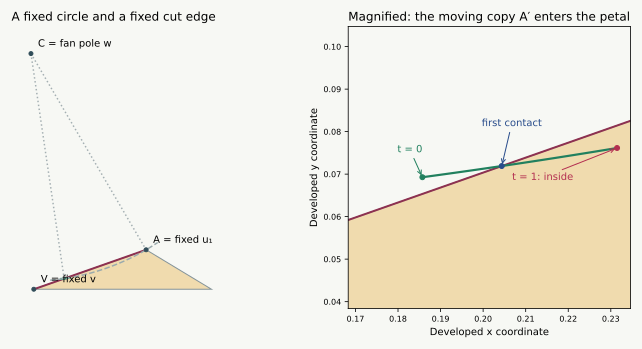

# The first collision during a minimum-vertex insertion

**13 September 2026 · A complete classification for one exact path.** This
page identifies when the original tree becomes unsafe on the previously
certified minimum-curvature insertion. It is not a universal bipyramid
proof. A different fixed tree is already certified safe along this entire path.

[Insertion and exact coordinates](BIPYRAMID_MORPH.html#failure) ·
[New general lemmas](BIPYRAMID_OVERNIGHT.html) ·
[Interactive solid and nets](bipyramid-morph-demo.html)

## What happens {#result}

Move $u_2$ from the midpoint of $u_1u_3$ to its target coordinates, with the
other six vertices fixed. Cut the five edges at $v$, together with $wu_1$.
There is a unique transition parameter $\tau$, with

$$\frac{6260373}{10000000}<\tau<\frac{6260374}{10000000}.$$

**The initial tree is nonoverlapping for $0\le t\le\tau$ and has
positive-area overlap for every $\tau<t\le1$.** At the transition a second
copy of $u_1$ touches the interior of edge $u_1v$ in the original petal.
Immediately afterward, that point is strictly inside the petal, causing
two face pairs to overlap simultaneously.

The five nonadjacent patch pairs stay safe during the whole insertion.
This example therefore exposes a **local slit obstruction**, not one of
the more distant obstructions left by the largest-distance-sum slit rule.

*The picture is a numerical illustration. The transition and the absence
of an earlier overlap are established by the proof and exact interval
checks below.*

## 1. A fixed triangle and a point moving on a circle {#circle}

In the developed net, let $C$ be the fan pole $w$. Let $A$ be the copy of
$u_1$ in the fixed triangle $V_0=vu_0u_1$, and $V$ its copy of $v$.
These three developed points stay fixed: neither $u_2$ nor either of its
moving triangles occurs in their placement.

The other copy $A'(t)$ of $u_1$ belongs to $V_1=vu_1u_2$ and
$W_1=wu_1u_2$. The fan's total angle is $2\pi-\kappa_w(t)$, so

$$A'(t)=C+R_{-\kappa_w(t)}(A-C).$$

Thus the relevant point travels on a **fixed circle**, of radius
$r=|A-C|$. Only the fan gap changes. This makes the first collision a
circle-and-line question instead of a simultaneous motion of ten triangles.

Use coordinates with $C=(0,0)$ and $A=(r,0)$, and write the unit direction
from $A$ toward $V$ as

$$d=(\cos\rho,-\sin\rho).$$

For this exact example the fixed patch $Q_0$ has an inward corner
$\pi+\rho$ at $u_1$, with $\pi/2<\rho<\pi$. Exact signs of the dot and
cross products between $A-C$ and $V-A$ establish this quadrant. The petal
$V_0$ lies on the left of its directed cut edge from $A$ toward $V$.

The signed side of $A'$ is

$$\det(d,A'-A)
=-2r\sin\bigl(\kappa_w/2\bigr)
 \cos\bigl(\rho-\kappa_w/2\bigr).$$

Since $0<\kappa_w<\pi$ throughout this example, its sign changes exactly
at the curvature threshold

$$\kappa_* = 2\rho-\pi.$$

It is negative for $\kappa_w>\kappa_*$, zero at equality, and positive
for $\kappa_w<\kappa_*$. A positive sign puts $A'$ on the petal's side
of the cut line. The exact checks also put it strictly on the inner sides
of the petal's other two edges throughout the path.

## 2. The fan gap shrinks strictly {#strict-curvature}

The curvature-transfer theorem proves that the old curvature at $w$
cannot increase. Here it actually decreases strictly. The following
argument applies to every old neighbor of an inserted vertex.

For $0<t\le1$, choose a normal direction exposing exactly the new edge
$x(t)y$. Every other old vertex lies strictly below its supporting plane.
Since $x_0$ lies in the old hull and is not $y$,

$$n\cdot x_0<n\cdot y=n\cdot x(t).$$

For any $s<t$, therefore $n\cdot x(s)<n\cdot y$. The direction $n$ is
inside the old vertex's normal cone at time $s$, but on its new boundary
at time $t$. A small spherical region beside $n$ belongs to the former
cone and not to the latter. Its positive area proves
$\kappa_y(s)>\kappa_y(t)$.

Such an exposing direction exists in the relative interior of the normal
cone of the actual edge $x(t)y$. All four incident edges are present and
nondegenerate throughout positive insertion times. This proves strict
loss at all four old neighbors; the two old nonneighbors retain their
curvatures. The inserted curvature is their strictly increasing total loss.

Consequently $\kappa_w(t)$ crosses $\kappa_*$ at most once. Opposite exact
side signs at the two rational bracket endpoints prove that it does cross
there, and continuity supplies a unique $\tau$.

## 3. Why there is no earlier overlap {#before}

The ordinary L7 threshold was expressed using the curvature of the slit
vertex. Its proof gives a sharper local test when the actual inward corner
is known.

**Refined local test.** Choose the sharper pole $v$ as source. If the only
inward flank corner at the slit has excess $\rho>0$ and

$$2\rho-\kappa_w\le\pi,$$

then all three exceptional local pairs beside that slit are safe.
If neither slit corner is inward, the local pairs are safe without this
inequality.

The through-fan part is precisely the cone argument in
[Steps 2–3 of the local proof](BIPYRAMID_OVERNIGHT.html#length-slit).
For crossing the gap, first check whether the inward flank's actual
extension fits inside the gap. If it does, the cones separate directly.
Otherwise $\kappa_w<\rho<\pi-\kappa_u$, where $u$ is the slit vertex.
The opposite copy $A'$ lies on or to the right of the cut line by the
signed-side formula, since $\rho-\kappa_w/2\le\pi/2$.
The directions from $A'$ into the opposite patch, relative to $d$, lie in

$$[\rho-\pi-\kappa_w,\,-\kappa_u-\kappa_w]\subset(-\pi,0).$$

That entire patch is therefore on the right of the cut line, whereas the
offending petal is on its left. Equality allows a boundary contact, not
interior overlap. This is the original L7 cut-line argument with its
actual angle condition retained instead of weakened to a curvature bound.

In the present path, exact interval checks establish
$\kappa_v>\kappa_w$ throughout. For $t\le\tau$,
$\kappa_w(t)\ge2\rho-\pi$, so the refined test settles the three local
pairs. The 27 common-vertex fan pairs are safe geometrically. The remaining
15 face pairs are strictly separated on a closed interval cover of the
entire path. Thus no pair overlaps before the stated collision.

## 4. Why overlap starts there and persists {#after}

For $t>\tau$, strict decrease of $\kappa_w$ makes
$\det(V-A,A'(t)-A)>0$. The other two oriented edge tests for $A'$ against
triangle $V_0$ stay strictly positive over the full interval. Thus $A'$
is strictly inside $V_0$ for every $t>\tau$.

Both nondegenerate triangles $V_1$ and $W_1$ have $A'$ as a vertex. Every
small enough neighborhood of $A'$ lies inside $V_0$ and contains interior
points of each of these triangles. Both $V_0/V_1$ and $V_0/W_1$ consequently
have positive-area overlap.

At $\tau$, the contact is in the open segment $AV$, not an endpoint:
the certified segment parameter lies strictly between zero and one. The
refined local test still applies at equality, so the net is safe with this
additional boundary contact. The other 15 pairs remain strictly separated.

## 5. Exact evidence and its limits {#certificate}

[The rational interval cover](results/bipyramid-first-collision.json) and
[its replay checker](bipyramid_collision.py) certify:

- the existing exact convex insertion geometry;
- both pole curvatures in $(0,\pi)$ and the strict source ordering;
- all 15 nonlocal pairs throughout all of $[0,1]$;
- the two other root-edge signs throughout the path;
- opposite cut-line side signs at the rational bracket endpoints;
- an interior edge parameter across that bracket, and the fixed reflex
  corner's exact quadrant and sign.

There are **491 closed rational parameter cells**. Their union is checked
to be exactly $[0,1]$ with no omitted intervals. Every relevant inequality
is evaluated with outward-rounded rational intervals; stored margins are
recomputed during replay. The decimal $0.626037\ldots$ is a convenient
label for the exact rational bracket, not a numerical proof premise.

The general local lemma and the normal-cone argument are written geometric
proofs. This checker is not their Lean formalization. The example does not
prove that all first collisions in all bipyramids have this form, or that
a single prescribed repair always succeeds.

## Next use of this example {#next}

A useful repair rule should recognize when the shrinking fan gap approaches
this cut-line threshold, then choose another slit or source. The alternate
tree already works on the whole example. The harder remaining task is to
prove a repair when the obstructing pair is **nonadjacent**, or when several
candidate slits fail together. The largest-distance-sum slit theorem removes
this particular local failure from its own candidate, which lets that
investigation focus on five nonadjacent patch pairs.
