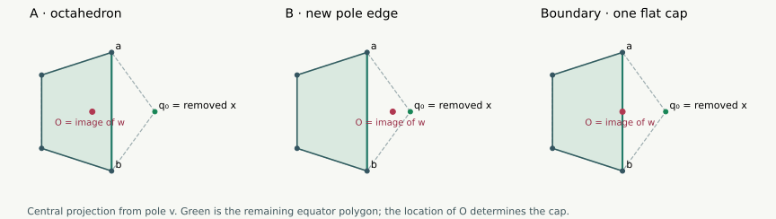
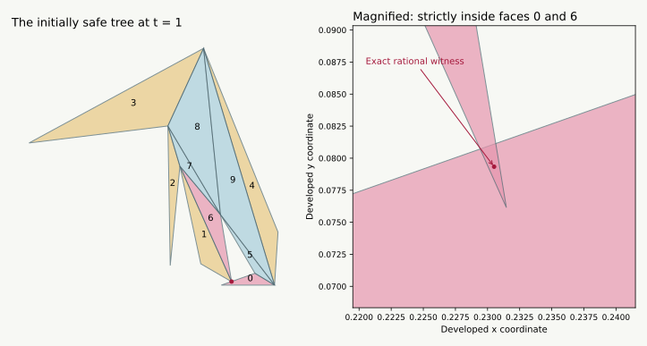

# Growing a pentagonal bipyramid from six vertices

**13 September 2026 · New geometric lemmas and two exact example families.**
The pentagonal bipyramid remains open in general. These arguments are
separate from the six-vertex manuscript and its Lean formalization.

[Seven-vertex overview](index.html#bipyramid) ·
[Interactive insertion and unfolded nets](bipyramid-morph-demo.html) ·
[Earlier five-patch proofs](BIPYRAMID_PATCHES.html)

## The idea, and what we can now say {#idea}

Your suggestion gives a useful new approach: start with a surface on which
one extra marked point is completely flat, then push that point out until
it becomes the seventh vertex. We can make this construction work for
**every equator vertex** of a convex pentagonal bipyramid, with the other
six vertices fixed. The solid stays convex, and the new vertex's curvature
increases monotonically from zero to its target value.

The starting six-vertex solid depends on which vertex we remove. Sometimes
it is an octahedron. Sometimes it gains an edge between the two poles,
giving a different solid with an especially simple safe unfolding.

The difficult step is carrying a safe net to the end. We now have an exact
counterexample to carrying an **arbitrary initially safe net unchanged**, even
when the moving vertex is the unique minimum-curvature vertex. Another net
works along that entire example. Thus this does not refute the proposed
inductive approach: it identifies the extra net-selection lemma it needs.

| Question | Result here | Scope |
| --- | --- | --- |
| Can an equator vertex be inserted from curvature zero? | **Yes** | Every convex pentagonal bipyramid |
| Does this preserve convexity and increase its curvature? | **Yes** | The full straight-line insertion |
| Are there several reductions to an octahedron? | **At least two** | Every convex pentagonal bipyramid |
| Does this flexibility grow with the ring size? | **At least $m-3$ reductions** | Any convex bipyramid with $m\ge5$ equator vertices |
| Must the minimum-curvature equator vertex reduce to an octahedron? | **No** | Exact rational counterexample below |
| Can every safe initial net be kept unchanged? | **No, even for the minimum vertex** | Exact rational counterexample below |
| Can we always choose or change cuts to reach the target? | **Open** | The missing existence lemma |

These results do not increase the number of complete patch-pattern proofs:
it remains **3 of 15**, and the whole-graph census remains **10 covered, 24 open**.

## 1. Three possible six-vertex starting shapes {#deletion}

Let $v,w$ be the poles, and $u_0,\ldots,u_4$ the equator in cyclic order.
The equator need not lie in a plane. Remove $x=u_i$, and let
$a=u_{i-1}$ and $b=u_{i+1}$. The four triangles incident to $x$ disappear.
The six other triangles remain strictly supporting faces of the smaller
convex hull: deleting a point cannot invalidate their strict supporting
inequalities. The hole has boundary $v,a,w,b$.

Every old vertex remains extreme, since its old exposing functional still
exposes it after a different vertex is deleted. The new hull is three
dimensional: any surviving face has another surviving vertex strictly on
its inner side. Its new faces therefore fill this four-sided hole using
only its four boundary vertices. There are exactly three possibilities:

| New cap | Reduced solid | Where to put the flat point $x_0$ |
| --- | --- | --- |
| Two triangles meeting along **$ab$** | An octahedron | Inside edge $ab$ |
| Two triangles meeting along **$vw$** | Both poles adjacent to all other vertices | Inside edge $vw$ |
| One quadrilateral **$vawb$** | The boundary between these cases | Inside diagonal $vw$ of that face |

The first two rows are geometrically different reductions of the same
seven-vertex graph. In the second row the pole edge is a real edge of the
smaller hull, although it is not an edge of the final bipyramid.

### A simple way to decide which row applies {#projection}

Project centrally from $v$ to a plane cutting all rays from $v$ through
the other vertices. Such a plane exists because $v$ is an exposed vertex.
The five equator images $q_i$ are the vertices of a strictly convex polygon:
this is the cross-section of the tangent cone at $v$. The image $O$ of $w$
is strictly inside that polygon. Indeed, $v$ and $w$ share no supporting
face, so the open segment between them lies inside the original solid.

<figure><figcaption>The equator need not be planar: this diagram is a central projection from v. The removed vertex is dashed off; the position of the other pole's image selects the reduction.</figcaption></figure>

Let $g_i\in(0,\pi)$ be the successive positive angular gaps from $q_i$ to
$q_{i+1}$ as seen from $O$. They sum to $2\pi$. On deleting $q_i$, the only
new gap is

$$h_i=g_{i-1}+g_i.$$

If $h_i<\pi$, $O$ is still inside the remaining polygon: the new edge is
$ab$. If $h_i>\pi$, $O$ is outside, becomes an extreme ray at $v$, and the
new edge is $vw$. At equality, $O$ is on the open segment $q_{i-1}q_{i+1}$;
the four cap vertices are coplanar and form the quadrilateral row.
This also proves the classification for nonplanar equators.

**More vertices really do give more choices.** For an $m$-vertex equator,

$$\sum_{i=0}^{m-1} h_i=2\sum_i g_i=4\pi.$$

When $m\ge5$, four values at least $\pi$ would already use the entire sum,
leaving nothing for the remaining positive values. Thus at most three
vertices fail the strict $h_i<\pi$ test. **At least $m-3=n-5$ vertices can
be removed to leave a smaller bipyramid.** In particular a pentagonal
bipyramid always has at least two octahedral reductions.

## 2. A convex insertion with monotonically increasing curvature {#morph}

Choose any $x_0$ in the open segment specified in the table, and let $x_1$
be the original vertex. Hold the other six points fixed and set

$$x(t)=(1-t)x_0+t x_1,\qquad 0\le t\le1.$$

At zero, the four triangles around $x_0$ are a flat subdivision of the new
cap. Each small triangle is nondegenerate. Intrinsically their angles at
$x_0$ sum to $2\pi$, including when $x_0$ lies on a bent polyhedral edge:
an interior point of an edge has no intrinsic curvature.

**Convexity lemma.** For every $0<t\le1$, these same ten triangles are
exactly the strictly supporting facets of a convex pentagonal bipyramid.

For each triangle and each vertex outside it, orient its supporting
volume determinant to be positive at $t=1$. It is affine in $t$: in its
four-point determinant only one point moves. Its value at zero is
nonnegative because the starting triangles subdivide a supporting cap;
its value at one is strictly positive. Hence it is positive for all
$0<t\le1$. These ten supporting triangles form the given closed
triangulated sphere, so they exhaust the hull boundary. No graph change
or nonconvex intermediate shape occurs.

**Curvature lemma.** The angular defect $\kappa_x(t)$ is nondecreasing
from zero to $\kappa_x(1)$.

Write $K$ for the fixed six-vertex hull, $d=x_1-x_0$, and
$h_K(n)=\max_{y\in K}n\cdot y$. The spherical normal cone at the inserted
vertex is

$$N_t=\{n\in S^2:h_K(n)-n\cdot x_0\le t\,n\cdot d\}.$$

The left side is nonnegative because $x_0\in K$. Membership for $t>0$
therefore implies $n\cdot d\ge0$, so $N_s\subseteq N_t$ whenever
$0<s<t$. Angular defect is the spherical area of this normal cone.
One way to see this identity is to note that the normal polygon's interior
angles are $\pi$ minus the original face angles; its spherical excess is
$2\pi$ minus their sum. Nested normal cones have nondecreasing areas.
The flat starting point has area zero, and continuity gives the endpoint.
For the standard normal-area identity, see
[Givental's geometry exercises, Homework 11](https://math.berkeley.edu/~giventh/hw140s.pdf).

This controls curvature at **the inserted vertex**. We do not assert that
it stays the minimum at every intermediate time, or that other curvatures
are monotone.

## 3. How to transfer a cut tree from six vertices {#lifting}

In either triangular-cap case let $e$ be the new edge of the smaller solid.
Take any safe original-edge cut tree of that solid.

- If it cuts $e$, replace that cut by the two halves through $x_0$.
- If it does not cut $e$, keep its cuts and attach $x_0$ as a leaf by cutting
  one of its four incident segments to a neighbor.

The result is a spanning tree using only edges of the eventual bipyramid.
At $t=0$ its developed triangles reproduce the old net, with a face
subdivision and possibly a zero-width slit. This follows by unfolding the
coplanar subdivisions across their uncut edges; their intrinsic placement
is unchanged. The operation therefore transfers any certified old tree,
not just one with a pole as source.

For an octahedral starting solid, the existence of an old safe tree is a
**dependency on the six-vertex result**; we do not revise or independently
formalize it here. The lifting statement itself needs only the supplied net.

For the pole-edge case there is a particularly simple starting tree: cut
the edge star at $v$, since $v$ is adjacent to every other vertex. It is a
shortest-path star and has a nonoverlapping unfolding by the
[edge-star argument](ARGUMENTS.html#edge-star).
After subdivision this becomes the five edges $vu_j$, together with $xw$.
At the quadrilateral boundary the same comparison uses the straight face
diagonal $vw$ as a shortest path; splitting it at $x_0$ again gives only
original bipyramid edges after insertion.

### When a safe starting net remains safe for a while {#stability}

**Strict-clearance lemma.** Fix one lifted tree. Suppose every pair of
triangles in its initial net either belongs to a consecutive uncut fan at
a common original vertex, or has strictly separated closed triangles.
Then the tree stays nonoverlapping for some $0\le t\le\varepsilon$.

A consecutive fan has angle sum at most $2\pi$ on the flat starting
surface and strictly less than $2\pi$ at a convex vertex; its face interiors
cannot overlap. For every other pair, its positive distance persists by
continuity of the developed coordinates. There are finitely many pairs,
so take the minimum of their positive continuity neighborhoods.

Simply knowing the initial net is nonoverlapping is weaker: unrelated
faces may touch on their boundaries. We must analyze those contacts or
certify strict clearance; we cannot silently invoke continuity.

## 4. What minimum curvature does, and does not, buy us {#minimum}

For seven vertices, total curvature $4\pi$ gives

$$\min_z\kappa_z\le\frac{4\pi}{7}\approx102.86^\circ.$$

That is a useful bound, but does not guarantee a small enough motion for a
net with an arbitrarily narrow clearance. Curvature measures a spherical
normal-cone area, rather than the distance between pieces of a chosen net.

The global minimum might also be a **pole**. Our insertion proof applies
to equator vertices. Restricting the choice to them gives only
$\min_i\kappa_{u_i}<4\pi/5$. A planar equator allows a pole to flatten
into its base polygon; a general nonplanar equator needs a separate
construction if we insist on keeping all five neighbors fixed.

### An exact minimum vertex which requires the pole-edge route {#pole-example}

Take

| Vertex | Coordinates |
| --- | --- |
| $u_0$ | $(1,0,0)$ |
| $u_1$ | $(0,1,0)$ |
| $u_2$ | $(-1,1/2,0)$ |
| $u_3$ | $(-1,-1/2,0)$ |
| $u_4$ | $(0,-1,0)$ |
| $v$ | $(9/10,0,10)$ |
| $w$ | $(9/10,0,-10)$ |

The unique minimum is $u_0$, with curvature approximately $1.621^\circ$.
Removing it exposes edge $vw$: the poles have $x$-coordinate $9/10$ and
all remaining equator points have $x\le0$. The starting point is
$u_0(0)=(9/10,0,0)$, and

$$u_0(t)=(9/10+t/10,0,0).$$

The cut tree consisting of all five edges at $v$ and edge $wu_0$ is safe
throughout this entire one-parameter family. **Eight closed rational
intervals cover all $0\le t\le1$**, and every interval passes the exact
pair checks described below. This is a proved family of shapes, rather
than eight sampled shapes. It does not cover arbitrary pole heights or
arbitrary motion of the remaining vertices.

## 5. A minimum-curvature insertion can spoil a safe initial net {#failure}

The following coordinates are exact terminating decimals. They define a
second convex pentagonal bipyramid; here labels 5 and 6 mean $v,w$.

| Vertex | $x$ | $y$ | $z$ |
| --- | ---: | ---: | ---: |
| $u_0$ | 2.86985 | 0.41002 | 0 |
| $u_1$ | 2.41136 | 0.64241 | 0 |
| $u_2$ | −0.41673 | 0.99119 | 0 |
| $u_3$ | −1.35765 | 0.90212 | 0 |
| $u_4$ | −2.61183 | −0.55766 | 0 |
| $v$ | 1.72924 | 0.42311 | 0.35891 |
| $w$ | 0.92266 | 0.68566 | −0.36188 |

The unique minimum is $u_2$, approximately $17.59^\circ$. Its removal gives
an octahedron with new edge $u_1u_3$. Insert it from that edge's midpoint.
Cut all five edges at $v$ and the slit $wu_1$.

At $t=0$ all 45 face pairs are safe: 27 by the uncut common-vertex fan
argument and 18 by strict separation. At $t=1$, faces $vu_0u_1$ and
$wu_1u_2$ have a strictly interior common point. In the development used
by the checker, that rational witness is

$$\left(\frac{2305109}{10000000},\frac{793357}{10000000}\right).$$

All six oriented edge tests at that point have strictly certified signs.
Thus this is positive-area overlap, not a rounding artifact or boundary contact.
The source triangle $vu_0u_1$ is placed with $v=(0,0)$, $u_0$ on the
positive horizontal axis, and $u_1$ in the upper half-plane.

<figure><figcaption>The initial tree at the final solid. The inset shows the small positive-area overlap; its existence is certified by exact signs, not by the drawing.</figcaption></figure>

**A better tree works along the whole path.** Cut the five edges at $w$
and the slit $vu_4$. A cover by 256 closed rational intervals certifies
all 45 pairs for every parameter from zero to one. Thus the example
refutes neither the existence of a good fixed tree for this deformation
nor the proposed approach with adaptive cuts. It refutes the assertion
that *any* initially safe tree remains safe merely because the inserted
vertex has minimum curvature.

[Move the vertex and compare these two trees →](bipyramid-morph-demo.html#viewer)

## 6. What the exact checks establish {#certificates}

[The saved rational inputs and certificates](results/bipyramid-morph.json)
and [the replay checker](bipyramid_morph.py) use outward-rounded rational
intervals with 160 binary fractional bits. No floating sign is a premise.

- Strict supporting determinants verify the target hull and the reduced
  six-vertex cap. Nonnegative start determinants, nonzero starting triangle
  areas, and the affine-support lemma certify every intermediate solid.
- The global minimum-curvature comparisons use products of complex numbers
  $\langle a,b\rangle+i|a\times b|$ for the incident face angles. Strict
  convexity puts the total angle in $(0,2\pi)$. Both chosen vertices have
  total angle in the lower half-circle. Other vertices in the upper half
  have smaller total angle; within the lower half, a positive determinant
  certifies the order. All half-circle signs and determinants are enclosed
  strictly. No approximate inverse trigonometry determines the minimum.
- A cut must be an original-edge spanning tree with a tree as uncut dual.
  A common-vertex pair is used only if **every face on the entire uncut
  path** contains that vertex. Merely sharing a vertex label is insufficient.
- Every remaining pair has a strictly separated projection. Over each
  closed parameter cell, all unfolded coordinates and separating-axis
  expressions are enclosed uniformly. The 8- and 256-cell covers include
  every parameter and both endpoints; these are interval proofs, not grids.
- The failing endpoint has a rational point strictly inside both triangles.
  Stored margins are outputs: replay recomputes all supporting, ordering,
  overlap, and separation signs.

The interactive drawings use rounded coordinates and are illustrations.
The checker and its written geometric dependencies are not a Lean artifact.

## 7. The next lemma to attack {#next-lemma}

The natural target is now more precise:

> **Open continuation problem.** For every convex pentagonal bipyramid,
> choose an equator vertex, one of its valid six-vertex reductions, and
> safe original-edge trees along its straight-line insertion, so that a
> safe tree exists all the way to $t=1$.

There are 1,805 original-edge spanning trees for this graph. The ten
pole-star-plus-slit trees are a useful smaller starting family, but have
not been proved sufficient. A six-vertex seed tree need not even have one
of the two poles as its source.

I would next study the **first loss of clearance**, starting with the ten
simple trees: identify which vertex meets which edge in the unfolded net,
then try to prove that changing the slit or swapping the pole prevents
that obstruction. We must cover the simultaneous-failure cases too;
showing that each individual failure has some repair at a few shapes
would not complete the proof.

The minimum-curvature choice is still a sensible candidate to compare
against the alternatives. The new reduction count suggests also keeping
all available octahedral starting points, since there are always at least
two. We now have a valid geometric path and exact examples with which to
formulate and test a specific collision-repair lemma.
