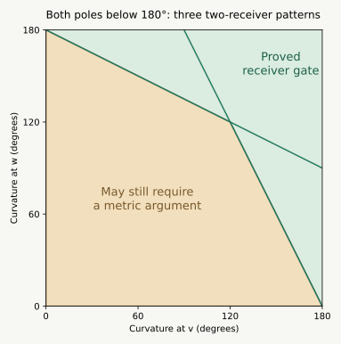

# Pentagonal bipyramid: a simpler local rule and a larger solved branch

**Later update, 13 September:** the [complete opposing-chain rule](BIPYRAMID_CHAIN_RULE.html) now closes the entire FCCBC / BCFCC class. The [radial extension](BIPYRAMID_RADIAL.html) brings the current count to **7/15** after the [adjacent-run theorem](BIPYRAMID_ADJACENT.html); the earlier reductions and open questions below are preserved as the record of how that result was reached.

**Later strengthening:** [the shortest-patch proof](BIPYRAMID_STAR_PATCH.html)
now covers every bipyramid with a pole curvature at least π, with no
restriction on its number of inward patches. The earlier proofs below
are preserved; the weighted receiver branch still adds low-pole cases.

**13 September 2026 · Overnight research, first pass.** These are written
geometric proofs, accompanied by seven exact example checks. The
pentagonal-bipyramid graph remains open. The six-vertex and Lean files are
unchanged.

[Seven-vertex overview](index.html#bipyramid) ·
[Vertex insertion](BIPYRAMID_MORPH.html) ·
[Earlier patch lemmas and notation](BIPYRAMID_PATCHES.html)

## What has advanced {#status}

There are now two useful choices of unfolding rule. They serve different
purposes and need not choose the same source or slit.

| Result | What is settled | What it leaves |
| --- | --- | --- |
| Largest-distance-sum slit, with the sharper pole as source | **All adjacent patch pairs**, for every convex bipyramid | Five nonadjacent patch pairs at seven vertices |
| At most two inward patches, with a pole curvature at least $\pi$ | **An entire safe net** | Both poles below $\pi$, or three or four inward patches |
| Two different convex receivers, with $2\kappa_p+\kappa_q\ge2\pi$ | **An entire safe net**, even with both poles below $\pi$ | An explicit region and two simultaneous extension inequalities |
| Curvature redistribution during insertion | The chosen target minimum stays minimum for the whole path | Curvature order alone does not preserve a net |

For the first rule, 30 of the 45 face pairs are settled. The other 15 form
five groups of three nontrivial face pairs. This is a reduction for a
specified candidate, not a percentage of shapes or a nearly completed
existence proof.

For the second result, **all five two-inward-patch patterns are covered
inside the large-pole branch**. One of those patterns was already covered
without that restriction. The total number of whole symbolic classes
remains **3 of 15**; four further classes now have the same simple proved
curvature branch. The full graph remains open.

## 1. Curvature is transferred from the old vertices {#curvature-transfer}

Use the insertion $x(t)=(1-t)x_0+t x_1$ from the
[insertion proof](BIPYRAMID_MORPH.html#morph), and let $K$ be the fixed
six-vertex hull. Put $P_t=\operatorname{conv}(K,x(t))$.

**Curvature-transfer theorem.** During this insertion:

- the inserted curvature is nondecreasing;
- the curvature at every old vertex is nonincreasing;
- only the inserted vertex's four neighbors can lose curvature, and their
  total loss is exactly its curvature gain.

The first assertion was proved by nesting the new vertex's normal cones.
For the second, observe that $P_s\subseteq P_t$ for $s<t$, since $x(s)$
lies between $x_0\in K$ and $x(t)$. At a fixed old vertex $y$, the outward
normal cone is

$$N_y(t)=\{n\in S^2:n\cdot(z-y)\le0\text{ for every }z\in P_t\}.$$

Enlarging $P_t$ can only shrink this cone. Its spherical area is the angular
defect at $y$, so that defect cannot increase. The faces at the two old
nonneighbors do not change at all. Finally all convex polyhedral surfaces
here have total curvature $4\pi$; subtracting the totals proves the transfer
identity. The marked point at $t=0$ has zero defect, so there is no extra
curvature at the flat starting subdivision.

**The minimum stays the minimum.** If $x_1$ has minimum curvature in the
target, then for every old vertex $y$ and every $t\in[0,1]$,

$$\kappa_x(t)\le\kappa_x(1)\le\kappa_y(1)\le\kappa_y(t).$$

A unique minimum at the target is unique throughout. Thus the earlier
exact failing insertion is stronger than its initial description: the
inserted vertex stays the minimum during the whole motion, yet its initial
cut tree eventually fails. This strengthens the geometric usefulness of
the minimum choice and also clarifies what it cannot guarantee.

### A curvature-based local rule in the minimum-equator branch

Suppose the global minimum $b$ lies on the equator. Choose the sharper pole
$v$ as source, the other pole $w$ as fan center, and an equator maximum $c$
as slit. The four equator vertices other than $b$ have total curvature
$4\pi-\kappa_v-\kappa_w-\kappa_b$, so

$$2\kappa_c+\kappa_w\ge
2\pi-\frac{\kappa_v-\kappa_w+\kappa_b}{2}>\pi.$$

The last inequality uses $\kappa_b\le\kappa_w$ and $\kappa_v<2\pi$.
The hypotheses of [Lemma L7](BIPYRAMID_PATCHES.html#lemma-l7) therefore hold
automatically. This settles its three local pairs, not the rest of the net.
During a minimum-vertex insertion this rule remains available at each
positive time; the maximizing slit or sharper pole may change.

## 2. A length-based slit settles the local part for every bipyramid {#length-slit}

Now no minimum-curvature assumption is needed. Let $v,w$ be the poles of
any convex bipyramid with $m\ge3$ equator vertices. Choose the pole names
so $\kappa_v\ge\kappa_w$, and define

$$d_i=|vu_i|+|wu_i|.$$

Choose any vertex $u$ attaining the maximum of the $d_i$. Cut every edge
at $v$, together with $wu$.

**Largest-distance-sum slit theorem.** The two patches beside this slit
have disjoint angular cones at $w$. Consequently all three exceptional
local pairs beside the slit are safe. All other adjacent patches are safe
by their common uncut equator vertex. Thus every adjacent patch pair is
safe for this rule, for any ring size.

### Step 1: neither slit corner is inward

In any flattened two-face patch, a corner at $u_i$ of at least $\pi$ forces
$d_i<d_{i+1}$, or the corresponding reverse inequality at the other corner.
For a reflex corner, $u_i$ lies inside the outer triangle formed by the
other three patch vertices. Apply the convex function
$z\mapsto |z-v_i|+|z-w|$ there: its values at the poles equal $|v_iw|$,
and its larger value at the other equator vertex is $d_{i+1}$.
The interior convex combination gives the strict inequality. A straight
corner lies on the pole-to-pole segment and gives the same strict conclusion.

At a maximum of $d_i$, neither incident patch can therefore have a corner
of at least $\pi$ at the slit vertex. Both corners there are strictly
below $\pi$. No flank cone protrudes into the fan gap at the slit.
A flank can still protrude toward the interior of the fan if its other
corner is inward; that is the issue in the next steps.

### Step 2: two elementary spherical-link bounds

Write $\Gamma_p=2\pi-\kappa_p$. At either pole, its edge directions form
a strictly convex spherical polygon of perimeter $\Gamma_p$, and the
direction to the other pole is strictly inside it. If $A$ is the direction
to $u$ and $X$ the direction to the other pole, then

$$2\,\operatorname{dist}(A,X)<\Gamma_p.$$

Extend the great-circle segment $AX$ to its other boundary point $B$.
Each of the two boundary paths from $A$ to $B$ is longer than $AX$;
adding them proves the inequality.

If one incident link side at $A$ has length $\omega$, omit it. The same
ray exits through the remaining boundary, giving

$$\operatorname{dist}(A,X)<\Gamma_p-\omega.$$

Also every link side has length below $\Gamma_p/2$, since the remaining
boundary path between its endpoints is strictly longer than that side.
These facts do not depend on the number of equator vertices.

### Step 3: bound the cones pointing into the fan

In the original triangle $wuv$, let $\alpha$ and $\beta$ be the angles
at $w$ and $v$, and put $r=|wu|$, $s=|vu|$, $D=|wv|$.

An inward flank has an outer triangle $wuP$, where $P$ is its unfolded
copy of $v$. Put $t=|wP|$. Then $t\ge D$. To see this, let $z$ be its
inward equator corner of angle $\theta>\pi$. The other route around the
spherical link at $z$ has length less than $2\pi-\theta$. Hence the actual
angle between $zw$ and $zv$ is smaller than the angle $2\pi-\theta$ in
the outer developed triangle. The cosine law gives $t>D$.

Let $\gamma(t)$ be the outer triangle's angle at $w$. If $\beta\le\pi/2$,
the cosine law gives

$$\cos\gamma(t)-\cos\gamma(D)
=\frac{(t-D)(tD-r^2+s^2)}{2rtD}\ge0,$$

because $r^2\le D^2+s^2$. Thus $\gamma(t)\le\alpha$.
Two inward flanks have total cone width at most $2\alpha<\Gamma_w$.
For one inward and one convex flank of fan angle $\omega$, use
$\alpha<\Gamma_w-\omega$ instead. Two convex flanks plainly have
combined width below $\Gamma_w$.

If $\beta>\pi/2$, then $r^2>D^2+s^2$, so every $\gamma(t)<\pi/2$.
The link at $v$ gives $\Gamma_v>2\beta>\pi$. Since
$\kappa_v\ge\kappa_w$, also $\Gamma_w\ge\Gamma_v>\pi$.
Two inward flank widths sum to less than $\pi<\Gamma_w$. One inward
flank and one convex flank sum to less than
$\pi/2+\Gamma_w/2<\Gamma_w$.

In every case the cones cannot meet through the fan. Step 1 excluded
meeting across its gap. This proves the theorem, including ties in the
pole comparison and in the maximum $d_i$.

### Exactly what remains at seven vertices

Write $Q_i=W_i\cup V_i$ for the five patches. For the selected tree,
all five within-patch pairs, all 20 adjacent-patch face pairs, and the five
additional nonadjacent $W_i/W_j$ fan pairs are settled: **30 of 45**.

The remaining groups are

$$Q_i\text{ against }Q_{i+2},\qquad i=0,1,2,3,4.$$

Each contains three nontrivial pairs: petal/petal and the two petal/fan
pairs. The two fan triangles are already safe. A missing proof for these
15 pairs does not mean that an overlap occurs; it specifies the remaining
obligations for this candidate.

## 3. Two inward patches are settled when a pole has curvature at least pi {#two-gap}

**Two-patch large-gap theorem.** A convex bipyramid with at most two
inward patches and at least one pole of curvature at least $\pi$ has a
nonoverlapping original-edge star-plus-slit unfolding. This holds for
any ring size $m\ge4$.

The cases with zero or one inward patch were already proved without the
curvature condition. Take exactly two. Inward corners cannot share an
equator vertex, so two consecutive patches cannot lean toward each other
across their common edge. The remaining cases exhaust the possibilities.

### Adjacent patches leaning in the same direction

Use the pole with curvature at least $\pi$ as fan center. Put the slit
immediately after the two forward patches, or before the two backward
patches. Their mutual pairs are safe by their common uncut equator vertex.
Each full inward patch cone has width below $\pi$, so neither can jump
the gap of size at least $\pi$ to a more distant convex patch. This is the
previous [Gap theorem](BIPYRAMID_PATCHES.html#theorem-gap).

### Two patches pointing into the same convex patch

The existing [Toward theorem](BIPYRAMID_PATCHES.html#theorem-toward) chooses
a pole at which their two extensions sum to less than that convex wedge.
It already settles this case without the large-gap assumption.

### All other configurations

Each bad patch now points into an immediately adjacent **convex** patch,
and those two receiving patches are different. For bad patch $i$, write
$C(i)$ for its receiver and $\ell_i^p$ for its extension at pole $p$.
The local angle identity from the one-patch theorem gives

$$\ell_i^v+\ell_i^w=\rho_i
<\omega_{C(i)}+\nu_{C(i)}.$$

Start with a pole $p$ of curvature at least $\pi$. Call an extension
**short** when $\ell_i^p\le\angle_p(C(i))$, and **long** otherwise.

- **Both short:** each bad cone reaches only its own wedge and its receiving
  convex wedge. Choose a slit outside those two bad/receiver joins. There
  are available joins because the two receiving patches are distinct.
  The only potentially meeting patches are adjacent and remain uncut there.
- **Both long:** the displayed inequality makes both extensions strictly
  short at the other pole. Switch poles and use the preceding choice.
- **Exactly one long:** keep $p$ and put the slit just beyond that bad
  patch's receiving convex patch, in the direction of its extension.
  The long cone can reach that receiver and enter the gap, but cannot jump
  a gap of size at least $\pi$: its whole width is below $\pi$. The other
  bad cone stays in its own two-patch block. This slit breaks neither
  bad/receiver join, and the two receivers are distinct.

In the last case the long cone meets no patch except its own receiver;
in the first two cases each cone meets only its own receiver. All such
adjacent pairs are safe by the common-vertex fan. The remaining patches
are convex and stay in disjoint fan wedges. This checks the entire net.
Equality in the short-extension test or in the pole-curvature threshold
causes no interior overlap.

## 4. A sharper condition for the two-receiver cases {#receiver-gate}

The last part of the preceding argument needs less than a half-turn gap.
It is enough that a long extension stops before the far end of the gap:

$$\ell_i^p\le\angle_p(C(i))+\kappa_p.$$

**Receiver-gate theorem.** Suppose there are exactly two inward patches,
each pointing into a different adjacent convex patch. If one pole $p$
satisfies

$$2\kappa_p+\kappa_q\ge2\pi,$$

then a star-plus-slit net is nonoverlapping. The same short/long selection
rule proves this, with $p$ as its initial pole. This applies to the three
canonical types BCBCC, BCFCC, and BFCCC.

For any long patch, the extension-sum identity and the spherical-link
side bound give

$$\ell_i^p-\angle_p(C(i))
<\angle_q(C(i))-\ell_i^q
\le\angle_q(C(i))
<\frac{\Gamma_q}{2}\le\kappa_p.$$

Thus the long extension fits into its receiving wedge and the gap.
If both extensions at $p$ are long, both are short at $q$, exactly as before.
Every case therefore has a safe tree. The boundary equality in the
curvature condition is included because the preceding side bound is strict.

A convenient symmetric sufficient condition is

$$\kappa_v+\kappa_w\ge\frac{4\pi}{3}.$$

Choose the larger-curvature pole as $p$. Then
$2\kappa_p+\kappa_q\ge3(\kappa_v+\kappa_w)/2\ge2\pi$.
For example, this includes pole curvatures near $128^\circ$ and
$124^\circ$, both well below a half-turn. Exact rational examples in all
three pattern types have been checked independently.

*This diagram applies only to the three distinct-receiver patterns. The
amber region is not a set of known failures; it is where this sufficient
curvature test alone does not finish the proof.*

### Precisely where this cone-selection argument can still fail

Without the curvature condition, the same rule succeeds if either pole
has both extensions short, or has one long extension that fits its receiving
wedge plus the gap. If one pole has both long, the other has both short.
Consequently the only unresolved two-receiver situation has **different**
long patches at the two poles, say $i$ at $p$ and $j$ at $q$, and

$$\ell_i^p>\angle_p(C(i))+\kappa_p,\qquad
\ell_j^q>\angle_q(C(j))+\kappa_q.$$

Equality is already safe. The extension identity forces
$\angle_q(C(i))>\kappa_p$ and $\angle_p(C(j))>\kappa_q$.
The strict link-side bounds then force both

$$2\kappa_p+\kappa_q<2\pi,\qquad
\kappa_p+2\kappa_q<2\pi.$$

This is an explicit restriction on a possible remaining obstruction.
It does not establish that every curvature pair in that region is
realizable, or that these angular inequalities imply actual triangle
overlap. A metric separation proof could still settle that situation.

### The conflicting preferences are real

A later [integer-coordinate example](BIPYRAMID_RECEIVERS.html#example)
certifies both simultaneous failed extension inequalities. So a proof
that this region is empty is impossible. Six original-edge nets still
unfold that example safely. For its whole opposing-chain pattern,
[a new selection argument](BIPYRAMID_RECEIVERS.html#chain) proves 43 of
45 face pairs safe and leaves one petal against one convex patch.
The petal/fan separation follows from the petal/petal separation, so
there is only one independent pair question.
An [auxiliary-octahedron bridge](BIPYRAMID_RECEIVERS.html#auxiliary)
closes a further branch, including that exact example.

### The remaining pair now has only a small-angle gap

The [next local analysis](BIPYRAMID_CHAIN_PAIR.html) proves that a long
receiver extension forces the large-fan angle inequality, so the
small-fan pocket is impossible. The whole large-angle branch is then
separated. In the small-angle branch, a short copied cut with a bounded
apex angle suffices; a new exact identity gives an additional sufficient
condition involving the seventh vertex. Four exact examples check these
applications. The whole symbolic class remains open.

## 5. Exact checks and next proof targets {#next}

[Seven rational examples](results/bipyramid-two-gap.json) and
[their exact replay checker](bipyramid_rule_checks.py) validate three
one-long choices, a choice that switches poles because both extensions
are long, and three examples with both pole curvatures below $\pi$.
All seven selected nets pass 45-pair checks using common-vertex fans and
strict rational interval separation. The examples also independently
check all three local pairs of the largest-distance-sum rule.

The universal theorems above do not use these examples as premises.
The finite checks verify their hypotheses and applications; they are not
Lean formalizations of the geometric proofs.

The [first-collision analysis](BIPYRAMID_COLLISION.html) also completely
classifies the old fixed tree on one exact insertion path. Its failure is
local to the slit and is removed by the local length rule's guarantee.

For the opposing-chain pattern, attack the two metric pairs in
[BIPYRAMID_RECEIVERS.html#chain](BIPYRAMID_RECEIVERS.html#chain). The
example there disproves simply excluding all conflicting extensions.
The other two distinct-receiver patterns still merit separate analysis. For adjacent same-direction patches, the
both-poles-below-$\pi$ branch remains a separate problem; the receiver
gate must not be applied when a bad patch points into another bad patch.

Three and four inward patches remain further targets. The new local
length rule still settles every adjacent pair there. Concentrate on one
of the five nonadjacent patch pairs, or prove a specific alternative tree
when that selected candidate fails.
