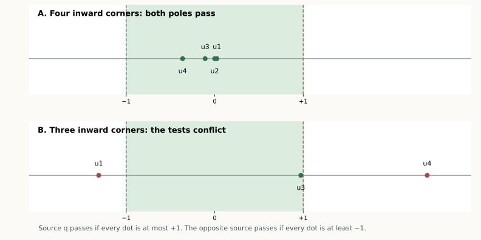

# One local test at every inward corner

**13 September 2026 · A stronger proved sufficient rule.** The rule works
for every convex bipyramid, with any number of ring vertices, provided
its local tests pass at one pole. It includes cases outside both supporting
half-spaces. Exact examples in six of the eight open classes fail the tests at both poles, so this is
not being presented as a complete solution.

The pentagonal bipyramid remains open; **7/15 whole patch classes** are
proved. This page gives a sharper description of the remaining geometry,
not another complete symbolic class.

[Overview](index.html#bipyramid) · [Supporting-plane theorem](BIPYRAMID_SOURCE_PLANE.html) ·
[Ordered-run theorem](BIPYRAMID_RUNS.html)

## The rule in geometric terms {#rule}

For each ring edge $u_i u_{i+1}$, flatten just its two incident triangles.
Let $D_i$ be the resulting distance between the two pole copies. This
length is independent of which pole is used as fan.

At an **inward ring corner** $a=u_i$, put

$$S_i=D_{i-1}D_i,\qquad H_i=|pu_i|^2-|qu_i|^2.$$

**Theorem Product Rule.** If

$$H_i\le S_i\quad\text{at every inward ring corner}, \qquad(1)$$

cut the star at source $q$, and slit the fan $p$ at a vertex maximizing
$|pu_i|+|qu_i|$. The entire edge unfolding is nonoverlapping.

To try the other source, change $H_i$ to $-H_i$. The $D_i$ do not change.
In the pentagonal case this means checking at most four scalar inequalities
at each pole. Weak inequalities and tied slit maxima are included in the
written theorem.

The test uses the actual edge lengths of the polyhedron. The two-face
developments compute five lengths; they are not a numerical experiment
standing in for the proof.

*Each dot is the ratio $H_i/S_i$ at one inward corner. Positions are rounded illustrations of the exact bounds in the linked certificates.*

## Why a failed angular ordering violates the product bound {#proof}

Use $p$ as fan and $q$ as source. The
[supporting-plane proof](BIPYRAMID_SOURCE_PLANE.html#order) established the
following reduction. Any reversal in the angular order of neighboring
source copies, in one of the relevant forward or backward combinations,
puts a copy $M$ strictly in the preceding indentation

$$\operatorname{conv}\{a,p,P\},\qquad |aM|=|aP|=s.$$

After reflection if necessary, their angles from ray $pa$ are
$0<\beta<\alpha<\pi$, where $P$ has angle $\alpha$ and $M$ has
angle $\beta$. Write $D=|pP|$, $E=|pM|$, and $r=|pa|$.

First, $E<D$. To see this directly, normalize $a$ to the origin,
$P$ to polar angle zero, $p$ to angle $\delta\in(0,\pi)$, and $M$
to angle $\eta\in(0,\delta)$. Both copies lie on the radius-$s$ circle.
Then

$$E^2=r^2+s^2-2rs\cos(\delta-\eta)
<r^2+s^2-2rs\cos\delta=D^2.$$

The cosine rule in the two triangles with base $pa$ now gives

$$\cos\alpha-\cos\beta
=\frac{D-E}{2r}\left(1-\frac{r^2-s^2}{DE}\right).$$

The left side is negative, while $D-E>0$. Therefore

$$|pa|^2-|qa|^2>DE=D_{i-1}D_i.$$

This is exactly a violation of (1). Thus (1) excludes every source-ray
reversal. The
[complete pair separation argument](BIPYRAMID_SOURCE_PLANE.html#separation)
then proves the net safe: consecutive inward runs use outer-triangle
clipping, different runs have disjoint angular cones, and the maximal
slit prevents a crossing of the opened gap.

No pole-curvature hypothesis is needed.

## The simple plane test only needs the inward corners {#corners}

Let $L=|pq|$. Every opened two-face pole distance satisfies $D_i>L$,
so $S_i>L^2$. Consequently it already suffices that

$$|pu_i|^2-|qu_i|^2\le L^2$$

**at inward corners only**. Equivalently,

$$(u_i-q)\cdot(p-q)\ge0$$

at those vertices. The other ring vertices may project beyond $q$.
This strengthens the whole-ring condition in the earlier theorem.

The product test is stronger still: it can pass even when some inward
corners project beyond the source plane. An exact four-inward example
below passes at both poles although the inward-corner plane test fails
at both.

## A concrete remaining obstruction {#remaining}

The two pole choices both fail this sufficient rule precisely when there
are inward corners $u_a,u_b$ with

$$H_a>S_a,\qquad H_b<-S_b.$$

Since $S_i>L^2$, these corners project beyond opposite ends of the
pole-to-pole segment. This identifies an actual conflict between two
local conditions; it is much more specific than an unspecified possible
overlap between distant faces.

Such conflicts do occur. The [exact records](results/bipyramid-product-rule.json)
include a previously solved two-inward shape and still-open three-inward
patterns with strict failures at both poles. The two-inward example is
covered by the separate complete chain proof. These are failures of
**the sufficient test**, not counterexamples to edge unfoldability.

The eight open classes now separate into three precise next targets:

| Still-open classes | Structure and next question |
| --- | --- |
| BBBCC, BBBBC | All inward patches lean the same way in one consecutive run. A common product-passing source remains a conjecture, **not a theorem**. |
| BBFCC, BBBFC, BBFFC | One consecutive block with mixed directions. The conjecture that a source always passes is **refuted exactly**. In all three new examples, both maximal-slit nets are nevertheless independently certified safe. |
| BBCBC, BBCFC, BCBFC | Two blocks of inward patches. Exact examples also show that both source tests can fail; a repair or a broader proof is needed. |

### Why the earlier five-class conjecture was revised

An initial floating search of 1,327,019 numerically accepted samples found
strict conflicts only in the last three classes. That suggested a
common-source conjecture for all five consecutive-block classes.
A targeted construction then refuted it in **three** of those five.
This is why the absence of a sampled conflict was never counted as proof.

The construction starts from a six-vertex numerical donor, inserts a new
ring vertex just outside its convex patch, and then independently verifies
the resulting seven rational vertices. Inserting near the patch's shortest
crossing gives CCBBF / BBFCC; inserting on either side gives FCBBF / BBFFC
and CBBBF / BBBFC. Every final solid has 40 strict supporting determinants
and strict product-test failures at both poles.

For each of these three solids, the exact checker also proves that $u_4$
is the unique maximum of the distance sum and checks all 45 pairs for
**both** corresponding source-star nets. They are safe. Thus these are
counterexamples to the proposed pole-selection criterion, not to the
actual maximal-slit rule and not to edge unfoldability. The exact records
retain both the failed tests and the successful nets. All supporting,
pattern, failure, maximum, and nonlocal-separation inequalities there are
strict. By continuity, each persists on a nonempty open neighborhood of
its coordinates; no numerical neighborhood radius is claimed.

A useful next step is to repair the two conflicting corners with the
pocket-and-disk lemmas already used for two inward patches, while checking
whether the additional third or fourth patch can reach that repair.

## A failure needs a neighboring vertex farther beyond the pole {#axis-neighbor}

There is another proved restriction. At an inward corner $a$, let $b$
be the other ring endpoint of its bad patch. The distance sum is larger
at $b$. If source $q$ fails the product test at $a$, then

$$H_b>H_a>S_a>L^2. \qquad(2)$$

Thus $b$ projects **even farther beyond $q$** than $a$ does. A failure
at the opposite source gives $H_b<H_a<-S_a<-L^2$.

To prove this, consider the function $f(x)=|px|+|qx|$ on the complete
line through the bad ring edge $ab$. Its unique minimum is the developed
pole distance $D_{ab}$. Indeed, flattening the two incident faces places
the pole copies on opposite sides of that line; their straight joining
segment meets the line and realizes this minimum.

At the inward endpoint $a$, let the two face angles toward $b$ be
$\alpha,\beta$. Their sum exceeds $\pi$, so

$$\frac{d}{dt} f\bigl(a+t(b-a)\bigr)\bigg|_{t=0}
=-|ab|(\cos\alpha+\cos\beta)>0.$$

Strict convexity along the line therefore puts its minimizing point
$x_*$ at a negative parameter, on the side of $a$ away from $b$.
If $H_b\le H_a$, the affine function
$H_x=|px|^2-|qx|^2$ would satisfy $H_{x_*}\ge H_a$.
But the reverse triangle inequality gives

$$H_x=(|px|-|qx|)f(x)\le L f(x).$$

It follows that $D_{ab}\ge H_a/L$. The other incident developed
pole diagonal is greater than $L$, so their product exceeds $H_a$,
contrary to the claimed product-test failure. This proves (2).

Consequently a two-pole conflict needs **four distinct ring vertices**:
the two failing corners and their farther neighbors. The positive and
negative axial inequalities make these four vertices distinct. This
proves, as a small base-case corollary, that the product rule always has
a passing pole for a triangular bipyramid, which has only three ring
vertices.

For the pentagonal bipyramid, exactly one ring vertex remains outside
those four witnesses. A concrete next reduction is therefore to study
how that extra vertex sits relative to the two failed patches. The
[exact conflict records](results/bipyramid-product-rule.json) now also
identify the required farther neighbor of every failed corner. This
localization alone does not complete the remaining proof.

## Exact checks {#checks}

The [replay checker](bipyramid_product_rule.py) verifies strict convexity,
the interval bounds for all developed diagonals, and the product tests.
For successful applications it independently checks all 45 face pairs.
For a claimed two-pole test failure it verifies a strictly negative
margin at each pole; it does not infer overlap from that sign.

All the universal claims above are geometric arguments. The exact examples
illustrate their scope and limitations; neither successful samples nor a
search without failures replaces any part of the proof.
