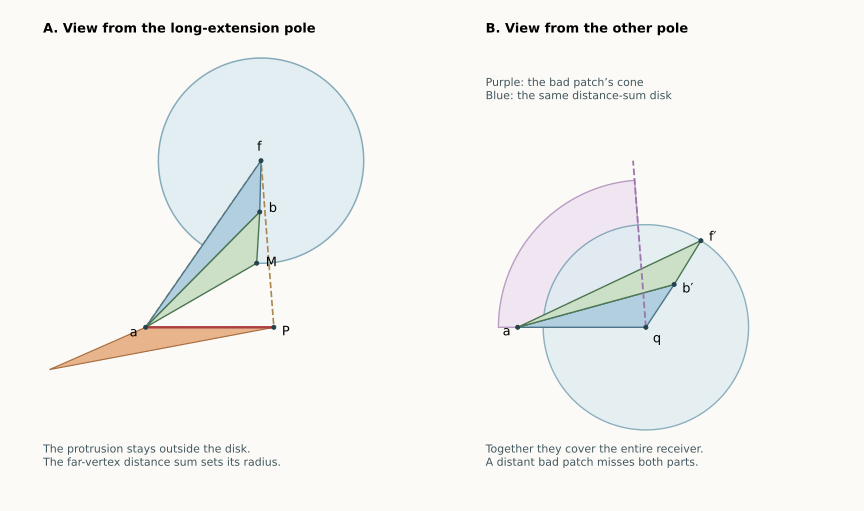

# Long receivers give a distance barrier

**13 September 2026 · Two further complete pattern classes, and a shorter
proof of the opposing chain.** The whole pentagonal bipyramid remains
open. The complete symbolic count is now **6 of 15**: all classes with
at most two inward patches except the adjacent same-direction class.
The arguments below concern every convex realization satisfying the
stated pattern, including nonplanar equators.

[Overview](index.html#bipyramid) · [Pattern definitions](BIPYRAMID_PATCHES.html) ·
[Earlier chain proof, preserved](BIPYRAMID_CHAIN_RULE.html)

## The idea in ordinary language {#idea}

A bad patch that passes its convex neighbor is constrained in two ways.
Viewed from that fan pole, its protruding part stays **outside a disk**.
The receiver's far vertex is well inside that disk, measured by the sum
of its distances to the two poles.

Viewed from the other pole, almost all of the receiver is protected by
the bad patch's angular cone. The part outside that cone fits **inside
a disk** of the same distance-sum radius. These two observations fit
together: use a disk to protect the nearby faces, and the other bad
patch's cone to protect the rest.

This replaces the final three-petal angle calculation in the earlier
chain proof. More significantly, the same distance barrier handles two
additional five-patch patterns.

*Planar schematics of the local proof. These are not a claimed full
polyhedron realization; the circles and cone illustrate the proved bounds.*

## 1. A local setup used in both lemmas {#setup}

Let an inward patch point into an adjacent convex receiver. Work first
with fan pole $f$. Write $a$ for the shared equator vertex, $b$ for the
receiver's other equator vertex, $P$ for the bad petal's copy of the other
pole $q$, and $M$ for the receiver's copy of $q$.

Assume the extension is **long**: it exceeds the receiver's fan angle.
The [long-receiver pocket proof](BIPYRAMID_CHAIN_RULE.html#pocket) gives

$$M\in\operatorname{int}T,\qquad T=\operatorname{conv}\{a,f,P\},
\qquad |aM|=|aP|.$$

The receiver is the convex quadrilateral with cyclic vertices $f,a,M,b$.
Its two triangles are the fan triangle $fab$ and petal $Mab$. A straight
corner at $b$ is allowed. The corner at $a$ is strictly convex.

Set

$$d_b=|fb|+|qb|=|fb|+|Mb|,\qquad
\Delta=\operatorname{dist}(f,[aP]).$$

The brackets denote the **segment**, not the whole line. This distinction
matters when the perpendicular foot falls beyond an endpoint.

## 2. The protrusion stays outside a disk {#shield}

**Shield lemma.** In this setup,

$$d_b<\Delta.$$

Every point of the bad petal lying in its extension beyond its own fan
wedge has distance at least $\Delta$ from $f$. Thus the whole protruding
part is separated from the closed disk of radius $d_b$ centered at $f$.
This statement concerns the protrusion; it need not hold for the portion
of the bad petal inside its own fan wedge.

Here is a proof including the three possible positions of the perpendicular
foot. Scale and place

$$a=(0,0),\quad P=(1,0),\quad f=(x,h),\quad h>0,
\qquad r=|f|>1,\quad D=|fP|.$$

The inequality $r>1$ follows because $M$ is on the unit circle and
strictly inside $T$, whereas $a$ is inside that circle and $P$ on it.
If $r\le1$, the strict interior of $T$ would be inside the open unit disk.

Let the ray $aM$ meet $[Pf]$ at $B$. Convexity of the receiver places
$b$ in $\operatorname{conv}\{f,M,B\}$. In particular, the corner at
$a$ puts $b$ between the rays $aM,af$, and the opposite side of the
receiver puts $b$ across $fM$ from $a$. Also $|B|>1$.

Let $E$ be the last point of $[Pf]$ on the unit circle. If $x\ge1$,
then $E=P$. Otherwise the power-of-a-point calculation gives

$$|fE|=\frac{r^2-1}{D}.$$

The point $B$ lies strictly between $E$ and $f$. The point $M$ lies on
the circular arc from $E$ toward the ray $af$, so $|fM|<|fE|$.
The convex function $z\mapsto |fz|+|Mz|$ on the triangle $fMB$ takes
value $|fM|$ at $f,M$. At $B$ its value is

$$|fB|+|MB|=|fB|+|B|-1.$$

This last expression is convex along $[Ef]$, with endpoint values
$|fE|$ and $r-1$. Hence the value at $b$ is bounded by the larger of
these two quantities, with strictness when that larger value equals
$\Delta$.

- If $x\le0$, then $\Delta=r$, and both $|fE|$ and $r-1$ are smaller.
- If $0<x<1$, then $\Delta=h$. We have $r-1<h$, and $|fE|<h$ because

  $$(r^2-1)^2-h^2D^2
  =(1-x)\bigl[(1-x)(1+x)^2-h^2(x+3)\bigr]<0.$$

  The last sign follows from $r>1$, equivalently $h^2>1-x^2$.
- If $x\ge1$, then $\Delta=D=|fE|$. The other endpoint value satisfies
  $r-1<D$. Since $B$ is strictly between $E,f$ and $|fM|<D$, the value
  at $b$ is still strictly below $D$.

This proves $d_b<\Delta$ in every case, including $x=0,1$.
Finally, any ray from $f$ into the bad patch's protrusion first crosses
$[aP]$, which gives the asserted radial lower bound.

An immediate consequence will be useful:

$$d_b<\Delta\le |fa|<|fa|+|qa|=d_a.$$

Thus a long receiver forces the distance sum to decrease at its far endpoint.
The bad-corner lemma already makes it decrease from the preceding vertex
to $a$.

## 3. At the other pole, a cone and a disk cover the receiver {#cover}

**Cone-and-disk lemma.** Use the other pole $q$ as fan, and keep the
shared equator vertex $a$ uncut. The convex receiver lies in the union of

- the full angular cone of its neighboring bad patch, and
- the closed disk centered at $q$ with radius $d_b$.

Only the portion of the cone meeting the receiver is relevant; this is
not an assertion that the bad patch itself fills its cone.

To prove this, put $a=0$, $P=(s,0)$, and write the old fan point as
$f=r(\cos\delta,\sin\delta)$. The old receiver source is
$M=s(\cos\kappa,\sin\kappa)$, where
$0<\kappa<\delta<\pi$ and $r>s$.
To switch fan poles, rotate the receiver about $a$ by $-\kappa$, sending
$M$ to $P$. Its other source copy is now

$$f'=r(\cos d,\sin d),\qquad d=\delta-\kappa>0.$$

Write $R=r/s>1$. Strict containment of $M$ in $T$ gives

$$R(\sin\delta-\sin d)>\sin\kappa. \qquad (1)$$

The ray $Pf$ bounds the bad patch's extension into the receiver. It meets
$[af']$ at $Y=t f'$, where

$$t=\frac{\sin\delta}{R\sin\kappa+\sin d},\qquad 0<t<1.$$

The copied receiver apex $f'$ lies beyond this cone boundary: rotation
decreases its polar direction as viewed from $P$, since $r>s$.
The receiver's other boundary ray lies at least as far in that direction,
by convexity. The receiver portion outside the bad cone is therefore the
quadrilateral $\operatorname{conv}\{P,b',f',Y\}$, where $b'$ is the
rotated far vertex.

We claim $|PY|<|Pf'|$. It suffices to show $t>2\cos d/R-1$.
After multiplication by its positive denominator, the difference has numerator

$$N=R\sin\delta-(2\cos d-R)(R\sin\kappa+\sin d).$$

Using (1),

$$N>(R^2-2R\cos d+1)\sin\kappa
       +2(R-\cos d)\sin d>0.$$

Equivalently,

$$|PY|^2-|Pf'|^2
=(t-1)r^2\left(t+1-\frac{2\cos d}{R}\right)<0.$$

The other three vertices of the clipped quadrilateral also lie in the
radius-$d_b$ disk: $P$ is its center, $|Pb'|<d_b$, and the triangle
inequality gives $|Pf'|<|Pb'|+|b'f'|=d_b$. Convexity of the disk completes
the proof. Straight receiver corners cause no difficulty.

## 4. The only remaining pole-selection situation {#selection}

For each bad patch with a convex receiver, the adjacent angle identity gives

$$\ell_i^p+\ell_i^q<\omega_{\mathrm{receiver}}^p+
\omega_{\mathrm{receiver}}^q.$$

Thus a bad extension cannot be long at both poles. With two bad patches,
either some pole has both extensions short, or the two poles have
**opposing preferences**, one long extension each. If both are short,
put the slit away from the inward corners; the receiver-cone proof gives
a safe net in the distinct-receiver cases below.

If either pole has curvature at least $\pi$, the
[large-pole theorem](BIPYRAMID_STAR_PATCH.html#large-pole) already gives an
edge unfolding. We may therefore suppose both pole curvatures are below
$\pi$. Every full patch cone then has width strictly below half the
fan's total angle. The [half-fan proof](#half-fan) is recalled below and
has no four-vertex-ring restriction.

All cuts below are the five edges at the nonfan pole plus the stated
single fan edge. Write $d_i=|pu_i|+|qu_i|$.

## 5. Separated bad patches pointing in the same direction {#theorem-separated}

**Theorem Separated.** Pattern **FCFCC**, canonical **BCBCC**, has a safe
edge unfolding for every convex realization.

Only opposing preferences need attention. Choose $p$ as the fan where
$Q_0$ is long into $Q_1$; at $q$, $Q_2$ is long into $Q_3$.
Then $Q_2$ is short at $p$. The bad-corner and shield lemmas imply

$$d_0>d_1>d_2>d_3>d_4.$$

Slit at $pu_0$. The protruding part of $Q_0$ lies outside a disk of
radius $\Delta_0>d_2$. Both $Q_2$ and $Q_3$ lie inside the radius-$d_2$
disk: their ring vertices have smaller pole distances, and each developed
source copy has distance at most the distance sum at either endpoint
of its patch. Convexity of the disk includes their triangles.
Thus $Q_0$ cannot meet either distant patch.

The cone of $Q_0$ has width below half the total fan angle, and the fan
angle of $Q_4$ is also below half. Consequently they cannot meet through
the fan; neither extends across the slit. The remaining neighbor $Q_1$
is safe against $Q_0$ by the uncut vertex fan at $u_1$.
The short $Q_2$ reaches only its own convex receiver $Q_3$, where the
same local argument applies. All other patch pairs have disjoint wedges.
This checks every face pair and proves the theorem.

## 6. Opposing bad patches with three convex receivers between them {#theorem-long-chain}

**Theorem Long Chain.** Pattern **FCCCB**, canonical **BFCCC**, has a safe
edge unfolding for every convex realization.

Again consider opposing preferences: $Q_0$ is long at $p$ into $Q_1$,
and $Q_4$ is long at $q$ into $Q_3$. The shield lemma gives

$$d_0>d_1>d_2,\qquad d_0>d_4>d_3.$$

Choose $p$ as fan if $d_2\ge d_3$. Otherwise use $q$ and reflect the
ring to exchange the two roles. Slit at $u_0$.

The two bad cones point inward from the opposite ends of the fan.
Their full widths sum to less than the total fan angle by the half-fan
lemma, so those cones are disjoint. The protrusion of $Q_0$ is outside
radius $\Delta_0>d_2$.

The central convex patch $Q_2$ lies inside the radius-$d_2$ disk, because
its endpoint distance sums are $d_2,d_3\le d_2$. It is safe against $Q_0$.
By the cone-and-disk lemma applied to the long $Q_4$ at the other pole,
$Q_3$ in the chosen unfolding lies inside the union of the bad $Q_4$
cone and the radius-$d_3$ disk. Both parts are separated from $Q_0$:
its cone is disjoint from the first, and its protrusion cannot enter the
second. Its own fan wedge cannot meet $Q_3$ either.

The short $Q_4$ can otherwise meet only its adjacent receiver $Q_3$.
The pair $Q_0/Q_1$ is also adjacent and safe. All remaining patches are
convex. This proves the whole net safe. The comparison $d_2=d_3$ is
included because the shielding inequality remains strict.

## 7. The earlier opposing chain now has a shorter proof {#shorter-chain}

For **FCCBC**, canonical **BCFCC**, the two receivers share the same far
vertex $u_2$. If no pole has both extensions short, use the fan where
$Q_0$ is long; $Q_3$ is long at the other pole. Slit at $u_0$.
The shield lemma puts the protrusion of $Q_0$ outside radius $d_2$.
The cone-and-disk lemma puts $Q_2$ inside the other bad cone together
with that disk. The two bad cones are disjoint by the half-fan lemma.
All other pairs are convex-wedge or adjacent-vertex separations.

Together with the already proved large-pole branch, this is another
complete proof of that whole class. The
[earlier angle-based proof](BIPYRAMID_CHAIN_RULE.html) is preserved and
remains independently useful; it does not need this radial argument.

## 8. The half-fan bound used above {#half-fan}

At a genuine pole, the closed convex spherical link has positive area
and perimeter $\Gamma=2\pi-\kappa$. Its two boundary routes between
an edge direction and a second boundary point give
$2\operatorname{dist}(A,X)<\Gamma$ for every direction $X$ in the link.
In particular, every fan-face angle is strictly below $\Gamma/2$.

For a bad patch viewed from fan pole $p$, use its **other**, nonreflex
equator endpoint $u$. Let $r=|pu|$, $s=|qu|$, $D=|pq|$, and $t$ the
developed pole-to-pole length. Its outer triangle contains the patch,
and the spherical triangle inequality at $u$ gives $t\ge D$.
Write $\alpha=\angle upq$, $\beta=\angle uqp$, and $\gamma$ for the
whole developed patch span at $p$.

If $\beta\le\pi/2$, then

$$\cos\gamma-\cos\alpha
=\frac{(t-D)(tD-r^2+s^2)}{2rtD}\ge0,$$

so $\gamma\le\alpha<\Gamma_p/2$. If $\beta>\pi/2$, then $r>s$,
so $\cos\gamma=(r^2+t^2-s^2)/(2rt)>0$ and $\gamma<\pi/2$.
When $\kappa_p\le\pi$, this is at most $\Gamma_p/2$, with the first
inequality strict. Convex patches use their fan-face angle directly.
This is the ring-size-independent argument from the
[n6 shared core](../n6/TIDY_CORE.html), stated here to expose its hypotheses.

## 9. Exact checks and the remaining classes {#status}

The complete necessary symbolic classes are now CCCCC, BCCCC, BCCFC,
BCFCC, BCBCC, and BFCCC: **6 of 15**. The remaining two-inward class is
**BBCCC**, two adjacent inward patches leaning the same way. The five
three-inward and three four-inward classes also retain open parts.
All their large-pole branches and the aligned-pole family are proved.
The whole graph and the whole n7 problem remain open.

[Exact local examples](results/bipyramid-radial.json) check both new
inequalities, including all three nearest-point positions on the segment.
The [replay checker](bipyramid_radial.py) uses outward rational intervals;
the universal claims are the written proofs. Exploratory searches for
opposing preferences in the two newly covered classes did not find them.
That absence is not used: the arguments above cover those configurations
whether or not they are realizable.
