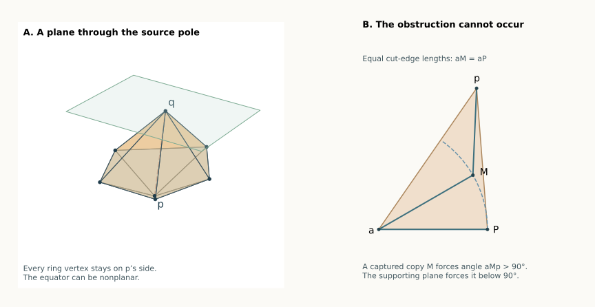

# A supporting plane at one pole settles every patch pattern

**13 September 2026 · A proved geometric family, for any ring size.**
The equator may be nonplanar, and the poles need not be aligned over it.
This theorem includes three and four inward patches. It does **not**
claim the whole pentagonal bipyramid is solved: the complete symbolic
class count stays **7/15**.

[Overview](index.html#bipyramid) · [Ordered-run argument](BIPYRAMID_RUNS.html) ·
[Earlier aligned-pole theorem](BIPYRAMID_ALIGNED.html)

## The condition and the unfolding rule {#rule}

Call the poles $p,q$ and the ring vertices $u_0,\ldots,u_{m-1}$.
Through $q$, draw the plane perpendicular to the line joining the poles.
Suppose the whole ring is on the same side of this plane as $p$:

$$(u_i-q)\mathbin\cdot(p-q)\ge0\qquad\text{for every }i. \qquad(1)$$

**Theorem Source Plane.** Under (1), cut every edge at $q$. Add one cut
$pu_s$, where

$$|pu_s|+|qu_s|=\max_i\bigl(|pu_i|+|qu_i|\bigr).$$

The resulting original-edge unfolding does not overlap.

This is an easily checked condition on the original solid. No unfolding
search, curvature ranking, or numerical tolerance is part of the rule.
Equality in (1), and ties for the maximum, are allowed. The theorem works
for every convex bipyramid with a strictly convex polyhedral edge structure.

The condition says that no ring vertex projects **past the source pole**
along the pole-to-pole axis. It need only hold at one pole. In particular,
it holds at both poles if all the ring projections lie between them.

*Illustrative geometry. The right-hand pocket is the configuration excluded by the proof; it is not claimed to occur in the solid on the left.*

## Why this condition helps {#idea}

The preceding proofs found a recurring obstruction: a bad patch can
extend so far that it traps the next pole copy in its triangular
indentation. That captured copy has an obtuse angle toward the fan
center and the shared ring vertex.

Condition (1) makes this impossible. Once captures are excluded, successive
pole copies occur in the correct angular order. Earlier bad patches can
then be separated from later ones by the outer triangles used in the
ordered-run proof. A convex patch between two runs separates their ends.

## 1. Every developed pole triangle has an acute source corner {#acute}

Set $L=|pq|$. Flatten the two faces at ring edge $u_i u_{i+1}$,
placing $p$ at the fan center and writing $P_i$ for the flattened copy
of $q$. Let $D_i=|pP_i|$.

Opening a strictly convex hinge to a plane increases the distance between
the opposite vertices, so $D_i>L$. This does not require the straight
segment $pP_i$ to stay inside the two-face patch. For example, resolve
both poles into components parallel and perpendicular to the hinge;
the opened squared distance is the parallel-component difference squared
plus the square of the sum of the two positive hinge distances. The
spatial distance is strictly smaller because the two face planes have
not yet opened to a common plane.

For either endpoint $a$ of this ring edge, (1) gives

$$|pa|^2-|qa|^2\le L^2<D_i^2.$$

Since $|aP_i|=|aq|$, the cosine rule in triangle $p,a,P_i$ gives

$$\angle aP_i p<\frac\pi2. \qquad(2)$$

This auxiliary triangle may include the indentation of an inward patch;
its metric statement is valid in either case.

## 2. Capturing an equal-radius copy would force the opposite angle {#capture}

Here is the local fact used to exclude captures. Suppose consecutive
patches meet at an uncut ring vertex $a$, and a source copy $M$ is
strictly inside the preceding indentation

$$T=\operatorname{conv}\{a,p,P\},\qquad |aM|=|aP|=r.$$

Let $e=(M-a)/r$. Then $e\cdot(M-a)=r$, while
$e\cdot(P-a)<r$ because the two copies are distinct points on the same
circle. Expressing $M$ as a strict convex combination of $a,p,P$
therefore forces

$$e\cdot(p-a)>r.$$

Consequently

$$(a-M)\cdot(p-M)=r^2-r\,e\cdot(p-a)<0,$$

so $\angle aMp>\pi/2$. This contradicts (2), applied to the patch
containing $M$.

This proof uses actual equal copies of one original edge. It does not
replace their lengths by unrelated free parameters.

## 3. The source copies stay in angular order {#order}

Cut at $u_s$ and relabel it $u_0$. Write

$$\theta_i=\sum_{j<i}\omega_j^p,\qquad\Gamma=\theta_m<2\pi,$$

and let $\phi_i$ be the source copy's angular position in the opened fan.
These are real angular positions, not angles reduced modulo $2\pi$.
For the three patch types:

- A convex patch has $\theta_i\le\phi_i\le\theta_{i+1}$.
- A forward inward patch has $\phi_i=\theta_{i+1}+\ell_i^p$.
- A backward inward patch has $\phi_i=\theta_i-\ell_i^p$.

We claim $\phi_i\le\phi_{i+1}$ at every uncut ring vertex.
Only four neighboring type combinations need attention.

**Forward then forward.** A reversal puts the next outer triangle's
source copy strictly in the preceding indentation, exactly as in the
[adjacent-run pocket proof](BIPYRAMID_ADJACENT.html#pocket). The source
copy's ray lies strictly between the two indentation rays; the positive
uncut angle at $a$ and equal edge lengths put it between the other sides.
Section 2 excludes it.

**Forward then convex.** The same argument applies to the convex patch's
source copy. If the forward extension passes that copy's ray, the copy
lies in the indentation. Equivalently, clip the convex receiver to the
bad extension cone, using its common uncut vertex. The two copies are
distinct, and the strict angular reversal gives strict containment.
Again Section 2 excludes it. Thus a forward run stops no later than the
source ray of its first convex receiver, a stronger conclusion than
merely stopping somewhere in that receiver's fan wedge.

**Convex then backward**, and **backward then backward**, are the reflected
versions of those two arguments. They give the same forward ordering of
the $\phi_i$.

All other allowed combinations are ordered directly by their fan wedges.
Forward then backward is impossible: both patches would be reflex at
the same ring vertex, exceeding its available angle $2\pi-\kappa_a$.

Finally, the maximal-distance-sum slit has no forward patch immediately
before it and no backward patch immediately after it. Indeed, a forward
patch strictly decreases $|pu|+|qu|$ along its ring edge; a backward patch
strictly increases it. Either forbidden orientation would contradict the
chosen maximum. Hence

$$0\le\phi_0\le\phi_1\le\cdots\le\phi_{m-1}\le\Gamma. \qquad(3)$$

No source ray, and therefore no patch cone, crosses the slit.

## 4. Ordered source rays separate all the patches {#separation}

A forward run is handled by the
[ordered-run outer-triangle induction](BIPYRAMID_RUNS.html#proof).
Its source angles are ordered by (3), so a bad patch is safe against
all later outer triangles in that run. Its first convex receiver is
safe by the same clipping argument. Reflection handles a backward run.

For clarity, here is why patches belonging to different runs cannot
introduce a missing pair. For indices $i<j$:

- If $Q_i$ is convex or backward, and $Q_j$ is convex or forward, their
  cones are separated by $\theta_{i+1}\le\theta_j$.
- If $Q_i$ is forward and $Q_j$ is backward, their cones are separated
  by $\phi_i\le\phi_j$.
- If both are forward, but an intervening patch $Q_r$ is not forward,
  then $\phi_i\le\phi_r\le\theta_{r+1}\le\theta_j$. Their cones are
  separated. Consecutive forward patches were covered by the induction.
  The backward/backward case is its reflection.
- A forward patch and a later convex patch are either a run and its
  first receiver, already covered by clipping, or have an intervening
  nonforward patch and are separated by the same inequalities. Reflect
  this for a convex patch followed by a backward patch.

Within each two-face patch the two triangles are on opposite sides of
an uncut equator edge. Adjacent patches are safe at their uncut ring
vertex; all nonadjacent combinations have just been covered. Boundary
contacts are allowed, while interior overlap is excluded. This proves
the theorem.

## What this removes from the remaining problem {#remaining}

The eight exact applications include seven low-pole examples in the
remaining three- and four-inward classes, and one example with a ring
vertex exactly on the source plane. Several satisfy the condition at only
one pole, showing why a two-sided slab is not required. The four-inward
example has a nonplanar equator.

**Stronger local version:** the [diagonal-product theorem](BIPYRAMID_PRODUCT_RULE.html)
shows that this plane condition is needed only at inward corners, and can
be relaxed further by using the two developed pole diagonals there.

For a counterexample to the existence claim to survive this theorem,
**both pole choices must fail (1)**. There must be a ring vertex projecting
beyond $p$ and another ring vertex projecting beyond $q$ along their axis.
These are distinct vertices. That is a concrete geometric restriction
on every still-open three- or four-inward case, in addition to the
previous low-pole-curvature and shortest-patch restrictions.

The condition is sufficient, not necessary. Failing it does not mean
that the selected tree overlaps, much less that the solid has no safe
edge unfolding. The rule is proved for every realization satisfying it;
finite examples do not establish the remaining universal claim.

[Exact applications](results/bipyramid-source-plane.json) and their
[replay checker](bipyramid_source_plane.py) verify the condition, select
the slit, and independently check all 45 face pairs on saved seven-vertex
examples.
