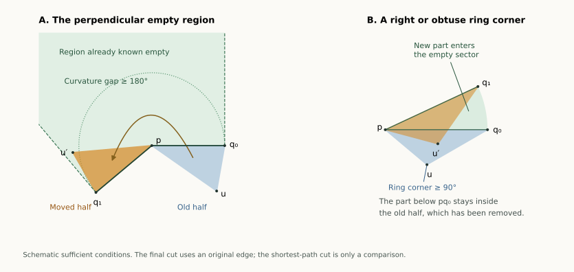

# A shortest patch gives an edge unfolding when a pole is sharp enough

**13 September 2026 · Written proofs, with exact examples checked separately.**
The following result applies to every convex bipyramid, with any number
of equator vertices and without requiring a planar equator:

> **Large-pole theorem.** If either pole has curvature at least
> $\pi$ ($180^\circ$), there is a nonoverlapping edge unfolding.
> Cut all edges at the other pole and one carefully selected edge at
> the large-curvature pole.

For the pentagonal bipyramid this covers the large-pole part of **all
15 patch-pattern classes**, including three and four inward patches.
The whole graph remains open. The subsequent [radial theorems](BIPYRAMID_RADIAL.html) brings the count
to **6/15 whole symbolic classes proved**; curvature-restricted progress
is counted separately.

[Overview](index.html#bipyramid) · [Earlier receiver analysis](BIPYRAMID_CHAIN_PAIR.html) ·
[Insertion from six vertices](BIPYRAMID_MORPH.html)

## What the construction does {#idea}

Start with an unfolding that is already known to work: cut shortest
paths from one pole to all other vertices. All but one of those paths
are edges. The exceptional path connects the two poles across two
triangular faces.

Those two faces form a convex quadrilateral, which the exceptional cut
splits into two triangles. We can replace that cut by an original edge:
move one of the half-triangles around the other pole until the halves
fit together again. The question is whether the moved piece runs into
the rest of the net.

A published star-unfolding theorem supplies an empty region beside that
pole. When its curvature is at least $180^\circ$, a suitable half-triangle
fits entirely inside this region. This proves that the edge replacement
is safe. The proof below also gives two conditions that can work with
both pole curvatures below $180^\circ$.

## 1. Find a shortest pole-to-pole path in one patch {#shortest}

Let $p,q$ be the poles and $u_0,\ldots,u_{m-1}$ the equator in cyclic
order, where $m\ge3$. A convex bipyramid here means a convex polyhedron
with exactly the triangular facets $pu_i u_{i+1}$ and $qu_i u_{i+1}$.
Indices are modulo $m$. All vertices and facets are genuine; no
coplanarity of the equator is assumed.

Flatten the two triangles along $u_i u_{i+1}$ and call their union $Q_i$.
A strictly convex patch has a straight diagonal from $p$ to the flattened
image of $q$ crossing the interior of that equator edge.

**Shortest-patch lemma.** A shortest surface path from $p$ to $q$ is such
a diagonal of a strictly convex patch. Its length is the least diagonal
length among the strictly convex patches.

**Proof.** The equator separates the two pole fans topologically. Every
surface path from $p$ to $q$ crosses it at some point $x$, and its length
is at least $|px|+|qx|$, by the Euclidean lower bound for each subpath.
Conversely, when $x$ is on $u_i u_{i+1}$, the two segments $px,qx$ lie
in the two facets of $Q_i$. Thus

$$d_P(p,q)=\min_{x\text{ on the equator}} (|px|+|qx|).$$

The minimizer cannot be an equator vertex $u_i$. The angles between the
edges to $p,q$ on its two sides sum to $2\pi-\kappa_{u_i}<2\pi$.
At least one is below $\pi$, so a small chord across that side strictly
shortens the broken path $p u_i q$.

The minimizer therefore lies in the interior of an equator edge.
Developing the adjacent faces gives a straight segment through that
interior point. It splits each of the two triangles into nondegenerate
triangles, so the two-pole diagonal is internal to the patch. This is
equivalent to both ring corners being strictly convex. Conversely every
such internal diagonal is an admissible surface path. Taking the least
length proves the lemma. Ties may be resolved arbitrarily. $\square$

The two pole angles of each patch are ordinary triangular face angles
and are below $\pi$. A straight ring corner cannot be selected by this
lemma: its diagonal would go through that corner, not through the
interior of the hinge.

## 2. The published empty region {#empty}

We use the point-source star unfolding. A source may be a vertex, and
one may choose a shortest path when there are ties. Its interior does
not overlap. In addition, suppose a vertex image $p$ is adjacent to two
source images $q_0,q_1$, each at distance $D$. The region on the exterior
side bounded by $pq_0,pq_1$ and the perpendicular rays from $q_0,q_1$
is empty of the net. The circular sector of radius $D$ between those
segments is empty as well.

These are the point-star result and its empty-region strengthening in
Kiazyk and Lubiw, *Star Unfolding from a Geodesic Curve*, Definition 1,
Theorem 4, and Lemma 6; the point-source results are in Section 2.
The [published paper](https://drops.dagstuhl.de/entities/document/10.4230/LIPIcs.SOCG.2015.390)
and its Figure 4 were inspected for this argument.

Write $p=0$, $q_0=D(1,0)$ and $q_1=D(\cos\kappa,\sin\kappa)$, where
$\kappa=\kappa_p\in(0,2\pi)$ is the exterior curvature gap. Call the
empty region $W$. Its perpendicular sides lie on

$$x\cdot q_0=D^2,\qquad x\cdot q_1=D^2.$$

We need only the following elementary **sufficient inclusion**, not an
assertion that these inequalities describe the whole region:

> A triangle with a vertex at $p$, lying angularly inside the exterior
> gap, is contained in $W$ if all its vertices satisfy
> $x\cdot q_j\le D^2$ for $j=0,1$.

To see this, take an interior radial segment from $p$ into the triangle.
It starts inside $W$. It cannot leave through either radial side of the
gap, and cannot cross a perpendicular boundary ray without first
crossing its supporting line. The two half-plane inequalities exclude
that crossing. Boundary cases follow by closure. This argument applies
also when $\kappa\ge\pi$, for which $W$ is unbounded and the gap is
not a convex sector. We apply it only to a triangle in a convex
subsector of the gap.

## 3. Replace the shortest cut by one original edge {#replacement}

Select a shortest patch $Q_k$. Cut the shortest $p$–$q$ path in it,
and cut all the edges $qu_i$. Each edge is itself a shortest surface
path, because it realizes the Euclidean distance between its endpoints.
These cuts have disjoint interiors and form a point-source star at $q$.
Thus its whole net is safe by the published theorem.

The diagonal cut divides $Q_k$ into two **geometric half-triangles**
$pq_0u_k$ and $pq_1u_{k+1}$. Each half can contain portions of both
original facets; the term does not mean that it is an original face.
The other $m-1$ complete patches and these halves form the star net.

Choose one of the halves to move and label its ring corner $u$. By
reflection if needed, its coordinates are

$$p=0,\qquad q_0=(D,0),\qquad
u=r(\cos\alpha,-\sin\alpha),\quad 0<\alpha<\pi.$$

Here $\alpha$ is the half-angle at $p$. Let $\beta$ and $\gamma$ be
its angles at $q_0$ and $u$, respectively.

Rotate this half about $p$ by the gap $\kappa$. The image of $q_0$
becomes $q_1$, and the half rejoins the stationary half along the former
shortest-path cut. Their opposite sides fit because they originally
formed the convex patch $Q_k$. The new separation is along $pu$.
The resulting unfolding has exactly the original-edge cut tree

$$T=\{qu_i:0\le i<m\}\cup\{pu\}.$$

No nonedge is cut in the final net. The shortest path is a device for
comparing two placements. To prove the final net safe it suffices to put
the moved half in the union of its old position and a region empty of
the stationary star net.

For seven vertices, even without a passing replacement condition, each
of these four candidate nets has **36 of its 45 face pairs already safe**.
There are 28 pairs inside the four unchanged patches, one within $Q_k$,
four between its fan triangle and the other fan triangles, and three
additional pairs against the adjacent patch across the uncut fan edge.
The last three share an uncut equator vertex. All nine remaining pairs
involve $Q_k$. This is a count of pair obligations for these candidates,
not a percentage of realizations proved unfoldable.

## 4. Three sufficient replacement conditions {#conditions}

### A. A right or obtuse ring corner {#obtuse}

**Obtuse-corner theorem.** If a shortest patch has an equator corner
$\gamma\ge\pi/2$, slit at that corner. This gives a safe edge net
with either choice of fan pole.

**Proof.** In the coordinates above, the corner condition is

$$u\cdot(q_0-u)\ge0,\quad\text{equivalently}\quad r\le D\cos\alpha.$$

In particular $r<D$ and $\alpha<\pi/2$. Along the segment from $u$
to $q_0$, squared distance from $p$ is nondecreasing: its derivative is
nonnegative initially by the displayed inequality and increases thereafter.
Its polar angle increases from $-\alpha$ to zero. Therefore the radial
boundary $R(\theta)$ of the half-triangle is nondecreasing on that interval.
All its points have radius at most $D$.

After rotation, any portion still at negative angles has radial boundary
$R(\theta-\kappa)\le R(\theta)$. It lies in the old half-triangle,
which has been removed. The portion at nonnegative angles lies in the
empty gap sector and has radius at most $D$. If $\kappa\ge\alpha$,
the entire rotated half lies in that empty sector. In either case it
cannot meet the interior of a stationary piece. Equality at $90^\circ$
is included. $\square$

### B. A half-triangle that fits the perpendicular empty region {#tangent}

**Empty-region test.** For either fan pole and either half, the replacement
is safe if

$$\boxed{\quad \kappa\ge\alpha,\qquad
\beta\le\pi/2,\qquad r\cos(\kappa-\alpha)\le D.\quad}$$

Indeed, the rotated half lies in the gap, with angular support
$[\kappa-\alpha,\kappa]$. Its ring vertex is
$u'=r(\cos(\kappa-\alpha),\sin(\kappa-\alpha))$.
The last condition gives its half-plane bound at $q_0$.
The other bound is $r\cos\alpha\le D$, exactly the condition
$\beta\le\pi/2$. The vertices $p,q_1$ satisfy both bounds too, since
$\cos\kappa\le1$. The sufficient inclusion from Section 2 puts the
whole triangle inside $W$. Its interior has strict half-plane bounds,
as $p$ satisfies them strictly, so it cannot overlap the stationary net.
Equality in the displayed conditions is harmless.

A simpler sufficient condition is

$$\boxed{\quad \kappa\ge2\alpha,\qquad\beta\le\pi/2.\quad}$$

For $0<\kappa<2\pi$ and $0<\alpha\le\kappa/2$,

$$\cos(\kappa-\alpha)-\cos\alpha
=-2\sin(\kappa/2)\sin(\kappa/2-\alpha)\le0,$$

so the remaining perpendicular bound follows. These tests may work
with both pole curvatures below $\pi$.

### C. A pole curvature of at least $\pi$ always supplies such a half {#large-pole}

We now prove the theorem stated at the top. Choose a pole $p$ with
$\kappa_p\ge\pi$ as the **fan pole**. The other pole $q$ is the cut-star
source. Choose any shortest patch.

Its angle at $q$ is less than $\pi$. The shortest diagonal splits that
angle into two positive half-angles, so one is strictly below $\pi/2$.
Move that half; in the notation above it has $\beta<\pi/2$.

At a genuine convex-polyhedron vertex, every face angle is strictly less
than half the total face-angle sum. For completeness, the edge directions
form a strictly convex spherical polygon in an open hemisphere; the
complementary chain between the ends of any side has length strictly
larger than that side, by the spherical triangle inequality. The strictness
follows from a full-dimensional tangent cone, which prevents the entire
complementary chain from following the same great-circle arc.

Let $\omega_k$ be the full angle of the selected fan triangle at $p$.
The internal shortest diagonal gives $\alpha<\omega_k$. Hence

$$\alpha<\omega_k<\frac{2\pi-\kappa_p}{2}
=\pi-\frac{\kappa_p}{2}\le\frac{\kappa_p}{2}.$$

Thus $\kappa_p>2\alpha$, and the simpler empty-region test applies.
It produces the required safe edge unfolding. The equality case
$\kappa_p=\pi$ retains the strict inequality $\alpha<\pi/2$, so it
is covered without a limiting argument. $\square$

This proof uses no curvature order between the two poles and no count
of inward patches. It also does not use the six-vertex theorem or its
formalization. Its external geometric dependency is the published
shortest-path star theorem and empty-region lemma.

## 5. A precise finite rule and its limits {#algorithm}

For a bipyramid with a pole of curvature at least $180^\circ$:

1. Flatten each pair of faces on an equator edge. Among strictly convex
   patches, choose one with least pole-to-pole diagonal length.
2. Use a large-curvature pole as the fan center. At the other pole,
   select the smaller of the two angles made by that shortest diagonal.
3. Cut all edges at the other pole, and cut the fan edge to the ring
   corner of the selected half.

The written proof guarantees a safe net. For an arbitrary bipyramid,
apply the same shortest-patch construction and test the obtuse-corner
or empty-region conditions for the four choices of fan pole and endpoint.
A passing condition guarantees success. Failure of the conditions means
only that these theorems do not settle the choice.

**The four choices alone are not a universal algorithm.** Two exact
rational examples have a unique shortest convex patch and positive-area
overlap for **all four** of its endpoint trees. Both lie outside the
proved conditions. This is a counterexample to that restricted selection
rule, not to edge unfoldability and not to the large-pole theorem.

The first example has patch pattern FCFCB and shortest patch $Q_3$.
Its four strict overlaps are:

| Fan pole | Slit | Overlapping original faces |
| --- | --- | --- |
| $p=5$ | $u_3$ | $W_3$ and $V_2$ |
| $p=5$ | $u_4$ | $W_3$ and $V_4$ |
| $p=6$ | $u_3$ | $V_2$ and $V_3$ |
| $p=6$ | $u_4$ | $V_3$ and $V_4$ |

Here $W$ denotes the chosen pole's fan and $V$ its opposite petals.
The record gives a rational point strictly inside both developed
triangles for each overlap. A second, differently labelled example has
pattern CBFCF and unique shortest patch $Q_0$.

The low-curvature problem therefore needs an additional choice, such as
a different patch, a different cut-tree shape, or a repair of the moved
half. Repeating the four shortest-patch choices at higher numerical
precision cannot establish a false universal rule.

## 6. What is covered, and what remains {#status}

| Scope | Status |
| --- | --- |
| Any bipyramid; either pole curvature $\ge180^\circ$ | **Proved**, for any equator size |
| Any bipyramid; a shortest patch has a ring corner $\ge90^\circ$ | **Proved**, either fan pole |
| Any bipyramid; one shortest-patch half passes the empty-region test | **Proved**, including some cases with both poles below $180^\circ$ |
| Pentagon; both poles below $180^\circ$ and none of these tests passes | **Open in general**; earlier patch and receiver theorems still cover parts |
| Pentagon; all four endpoint choices of a shortest patch always work collectively | **Refuted** by two exact examples |
| All pentagonal bipyramids | **Open** |

This is a substantial reduction of the geometric region still needing
work, not a percentage of all shapes: there is no uniform distribution
on the space of convex realizations being used here. The original graph
census stays **10/34 whole graphs covered**. The complete symbolic-pattern
count is now **6/15** after the separate radial theorems; all nine other classes have their
large-pole branch covered, whenever that branch is geometrically realizable.

A further [aligned-pole theorem](BIPYRAMID_ALIGNED.html) covers every
planar equator with poles on the same perpendicular line, at arbitrary
heights, and preserves one cut tree throughout the lower-pole insertion.
It includes four-inward low-curvature examples outside the conditions here.

For the opposing-receiver pattern, the separate
[complete chain rule](BIPYRAMID_CHAIN_RULE.html) now settles the entire
symbolic class, including its small-angle branch.
These are complementary routes; neither makes the other obsolete.

## Exact examples and reproducibility {#checks}

The [exact data](results/bipyramid-star-patch.json) and
[replay checker](bipyramid_star_patch.py) certify six successful examples:
three and four inward patches under the large-pole theorem, an obtuse
ring corner, the twice-half-angle test, and the general empty-region test. A further large-pole example has
two acute ring corners, so it demonstrates a case outside the obtuse-corner
theorem.
They also certify the two four-tree failures just described.

For each example the checker proves strict supporting planes for all ten
facets, identifies all convex patches, and compares their developed
squared diagonal lengths by outward rational intervals. It verifies the
selected condition and independently checks all 45 face pairs of the
successful net. Failures use strict interior-point witnesses.

Angles use Machin's formula and rational alternating-series bounds for
arctangent; the perpendicular tests additionally use algebraic angle
products. Floating searches discover candidates and generate drawings,
but never supply a proof predicate. These finite certificates validate
specified inputs. The universal conclusions are the written arguments
above, subject to independent mathematical review; they are not claimed
as Lean formalizations.
