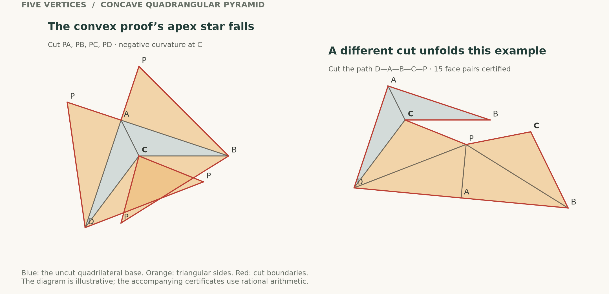

# Topological convexity: the five- and six-vertex branch

13 September 2026. Isolated research on `codex/topological-n5-n6`, based on
commit `5b21be4`. Scope: **n = 5 and n = 6 only**. No universal new theorem
for arbitrary topologically convex five-vertex polyhedra is claimed.

## The question in the attached paper

Akitaya, Demaine, Eppstein, Tachi and Uehara, *Ununfoldable polyhedra with
6 vertices or 6 faces*, Computational Geometry 103 (2022), 101857, already
answer the unrestricted six-vertex question **negatively**. Their Theorem 5
and Lemmas 7-8 construct a topologically convex polyhedron with six vertices,
seven faces, and no edge unfolding. The example has one concave quadrilateral
and six triangles. It is not a counterexample with convex faces or with only
triangular faces.

Their actual outstanding questions in our vertex range are:

| Scope | Status relevant to this branch |
| --- | --- |
| Five vertices, five faces: quadrangular pyramid | Nonconvex case is Conjecture 9; not settled here |
| Five vertices, six faces: triangular bipyramid | Nonconvex case is Conjecture 9; partially extended here |
| Six vertices, five faces: triangular-prism graph | Lemma 10 proves a valid geometric realization is convex; existing convex results apply |
| Six vertices, exactly six faces | Explicitly open in the paper; pentagonal pyramid and prism-with-one-diagonal types |
| Six vertices, unrestricted face count | False: Theorem 5 has seven faces |

The seven six-vertex graph types remain the same under topological convexity.
The face counts for them are 5, 6, 6, 7, 7, 8, 8. This classification does not
imply that the seven convex geometric arguments extend.

The [2025 update by Demaine and O'Rourke](https://www.gfalop.org/updates/22.4.pdf)
still lists the small remaining cases as open. An older
[2019 conference abstract](https://erikdemaine.org/papers/MinimalUnunfoldable_JCDCGGG2019/paper.pdf)
announced the five-vertex result with its proof omitted; the later attached
journal article instead states it as Conjecture 9. The older announcement
must not be substituted for the journal's status. This is a targeted
literature check, not a claim of exhaustive novelty verification.

## Results of this investigation

1. **The full n=6 extension is impossible.** A rational-coordinate instance of
   the paper's construction has been checked using exact arithmetic. Its
   original graph is precisely the octahedron-minus-one-edge type in our
   convex manuscript. All 224 original cut trees are excluded by local
   angular obstructions. See [the exact examples](EXACT_EXAMPLES.md).
2. **The n=5 pyramid cut rule actually fails.** For every concave quadrangular
   pyramid, the reflex base vertex has negative curvature. Cutting the apex
   star leaves that vertex as a cut-tree leaf, forcing local overlap. A fixed
   rational example has a different successful cut, certified across all
   15 pairs after an uncut subdivision of the base.
3. **Changing the bipyramid's star source is not enough.** An explicit
   triangular bipyramid has two negative-curvature equator vertices. All
   three possible four-edge equator stars fail locally. Thus a repair for
   arbitrary n=5 needs additional cut trees, even when every face is triangular.
4. **A genuine partial extension survives.** Every topologically convex
   five-vertex polyhedron with strictly positive curvature at every vertex
   has an original-edge unfolding. The proof uses intrinsic convex
   realization and a shortest-path star, and allows ambient nonconvexity.
   See [the proof and its boundaries](POSITIVE_CURVATURE.md). This is a
   written corollary of established theorems, not a claimed new literature
   result or a Lean formalization.



## Where the existing proof uses geometric convexity

Two current proof sources were inspected: the committed geometric manuscript
and the newer, untracked five-vertex Lean work in the original workspace.
The latter was read without editing it. The relevant files are copied into
`reference_snapshot/lean_statement/` with hashes in `provenance.json` so this
audit is not silently changed by continuing work elsewhere. These are audit
snapshots, not a separately buildable Lean project.

### The current five-vertex Lean proof

| Dependency | Exact location in the snapshot | What fails under topological convexity |
| --- | --- | --- |
| All base points lie on one side of a hinge | `Geometry/FacetHingeSides.lean`, `exists_nonnegative_hinge_coordinates`, lines 40-61 | Lines 47-54 use an actual supporting plane of the solid. A reflex base can straddle a boundary-edge line. |
| Put each side triangle outward from the whole base | `Geometry/TrianglePetal.lean`, `exists_triangle_petal`, especially `same_side` and `all_outward` | A local outward placement need not miss a concave polygon elsewhere. The preceding supporting-plane step is essential. |
| Separate entire side faces using vertex inequalities | `Geometry/PyramidCertificate.lean`, `unfolding_of_copies` | The proof uses convex hull descriptions and convexity of original faces. These do not describe a concave base. |
| Vertices and edges are exposed/extreme | `Geometry/EdgeHullSeparation.lean`, lines 8-24 | A topological vertex can lie strictly inside the convex hull of the other vertices; an original edge need not be an exposed segment of the hull. |
| The pole segment crosses the equator triangle | `Geometry/BipyramidRadon.lean`, `pole_segment_meets_equator` and `strict_equator_crossing`, lines 38-88 | Identifying the Radon partition with the two poles uses the preceding exposed-edge property. In a dented bipyramid the pole segment can miss the entire equator plane. |
| The affine weights have the needed signs | `Geometry/BipyramidWeights.lean`, `exists_positive_radon_weights`, lines 23-44 | Positive pole and equator weights come from that strict crossing; topology does not imply them. |
| Increased distances imply the missing distance increases | `Geometry/RadonMetric.lean`, `radon_missing_distance_gt`, lines 26-48 | The algebraic identity survives, but the inference uses `a_pos`, `b_pos`, `s_pos`, and `v_nonnegative`. Signed weights cannot simply be substituted. |

The five-point identity `radon_distance_identity` itself does **not** need
convexity: it is an inner-product identity. The failure is in obtaining the
geometric sign hypotheses and distance inequalities that make it useful.

For a concrete example, use equator
`A=(-1,-1,0), B=(1,-1,0), C=(0,1,0)` and poles `P=(0,0,3), Q=(0,0,1)`.
The resulting two nested triangular caps form an embedded nonconvex sphere.
The segment PQ lies above the equator plane. Moreover,

    Q = (1/3)P + (1/6)A + (1/6)B + (1/3)C,

so Q is not extreme. Both the claimed ambient Radon crossing and the
extreme-vertex premise fail. Nevertheless, reflecting Q below the equator
gives a strictly convex bipyramid with the same original triangle metrics.
It unfolds by transferring those nets back. This is an exact example where
ambient convexity is unnecessary for the conclusion but is used by the
current direct proof.

### The six-vertex geometric manuscript

| Dependency | Location in the isolated worktree | Audit |
| --- | --- | --- |
| Planarity, 3-connectivity, minimum degree, small graph classification | `n6/TIDY_PROOF.md`, lines 18-51 | Survives: these are part of topological convexity. |
| Original edges are shortest paths | Same file, lines 22-24 | Survives: a straight edge realizes ambient Euclidean distance. Its shortest-path image is unique. |
| Nonoverlap of that shortest-path star | Same file, lines 24-26 | Requires a convex intrinsic metric. Topological convexity alone supplies no such metric. |
| `0 < kappa_x < 2*pi` | `n6/TIDY_CORE.md`, lines 14-15 | The upper bound survives for genuine nondegenerate corners; the lower bound fails. Total signed curvature is still 4*pi. |
| Shared-vertex separation | Same file, lines 30-37 | Needs the developed incident sector to total at most 2*pi, and whole-face containment in the used sector. Negative curvature defeats local separation. |
| Closed tangent-link bound for an arbitrary direction toward another vertex | Same file, lines 44-79 | Uses a convex spherical link and containment of the relevant chord direction. These are ambient geometric hypotheses. |
| The slit separator and finite-cut contact proof | Same file, lines 97-223 | Use positive curvature gaps and the preceding link bound, including strict determinant signs. A negative gap changes the separation argument. |
| Pocket/base/apex cones | Same file, lines 245-375 and 404-440 | The planar arguments remain valid under their stated inequalities and containments; topology does not imply those hypotheses. |
| Flat triangulation into an octahedron | `n6/TIDY_PROOF.md`, lines 55-57; `n6/PAIRED_POLE_RULE.md`, lines 112-121 | The required diagonal can lie outside a concave original quadrilateral. This happens in our exact six-vertex example. |
| Original-face comparison and reassembly | `n6/TIDY_PROOF.md`, lines 66-72; `n6/TIDY_CORE.md`, lines 398-440 | A face diagonal must actually lie in the face; convex polygonal face/cone arguments cannot be applied to a reflex polygon without replacement. |

There is a useful distinction within the link argument. If all incident
faces are triangles, a single face angle is a shortest spherical arc and is
at most the length of the complementary link path, whether that spherical
link is convex or not. With a nonplanar vertex the inequality is strict.
Thus the **face-angle-only** bound `2*angle < total angle` and the corresponding
link slacks in the paired-pole identity do not inherently require a convex
solid in that triangular setting. The stronger bound for an arbitrary
direction toward a nonneighbor does require more. The algebraic paired-pole
identity also survives wherever its triangulated incidence is valid; its
other sign, refinement and separation hypotheses still need proof.

The exact counterexample diagnoses the refinement particularly clearly.
In the paper's labels, the quadrilateral ABCD is concave at C. Adding BD
would produce the octahedral graph, but BD exits the face. AC is the valid
interior diagonal; adding it produces a different graph. Neither changing
the sign convention for curvature nor calling BD an uncut flat hinge fixes
this geometric failure.

## What remains to research, within n=5 and n=6

* For concave quadrangular pyramids, replace the apex star by trees where the
  reflex base vertex has cut degree at least two. The single successful
  Hamiltonian path above is a point certificate, not a universal rule.
* For arbitrary triangular bipyramids, handle negative-curvature configurations
  using cuts beyond the three equator stars. The two-saddle example rules out
  a complete proof based only on selecting one of those stars.
* For exactly six vertices and six faces, keep the pentagonal pyramid and
  prism-with-one-diagonal branches explicit. Do not import the convex dome,
  supporting-plane, or diagonal assumptions without checking them.
* The six-vertex convex-faced and triangulated questions are narrower than the
  paper's negative example. Nothing here supplies an ununfoldable example in
  either of those narrower classes, or proves all of them unfold.

The zero-curvature boundary of the positive-curvature partial theorem is
not proved in this branch. No entire remaining nonconvex graph type has been
settled here, and no claim from the main research branch has been modified.

## Reproduction and evidence limits

From this worktree's root, using Python 3:

```sh
python3 topological_n5_n6/exact_topological_audit.py
python3 topological_n5_n6/n5_net_certificate.py
```

The first check uses only integers and rational numbers. It checks embedded
face incidence, triangle intersections, nonflat original hinges, local
angle inequalities, and the finite cut-tree enumeration. The second uses
the repository's outward rational interval arithmetic to certify one net.
Saved outputs are `verification.json` and `n5-net-verification.json`.
These are replayable mathematical computation checks, not a Lean proof or
independent human review of the new written arguments. The diagram uses
floating-point coordinates only for illustration.

The source PDF is `/Users/sl/Downloads/unfoldable6.pdf`; its SHA-256 and the
audited proof snapshot hashes are recorded in `provenance.json`. The paper's
[author bibliography page](https://erikdemaine.org/papers/MinimalUnunfoldable_CGTA/)
records its published reference. Relevant source pages are 1-2 (definitions
and open cases), 5-6 (the six-vertex counterexample), and 6-7 (Conjecture 9).
